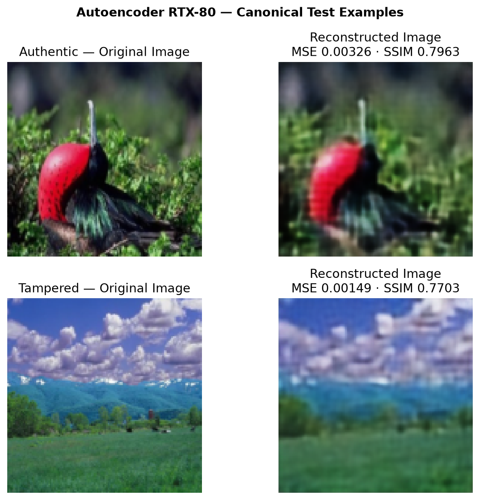
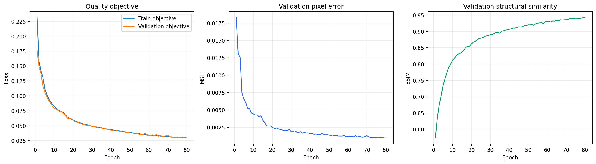
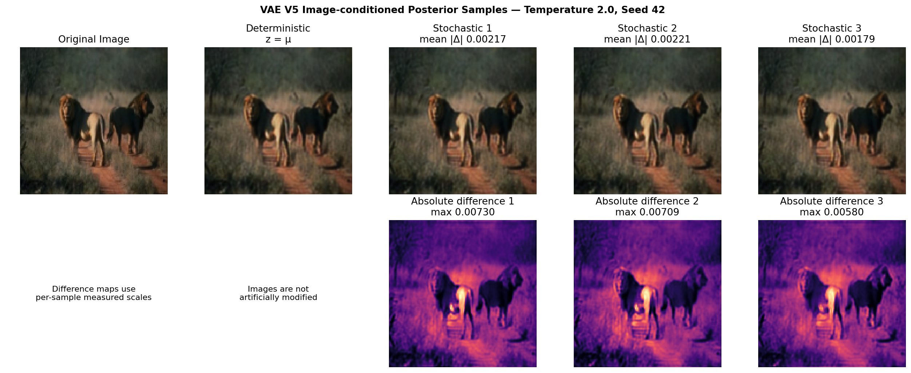
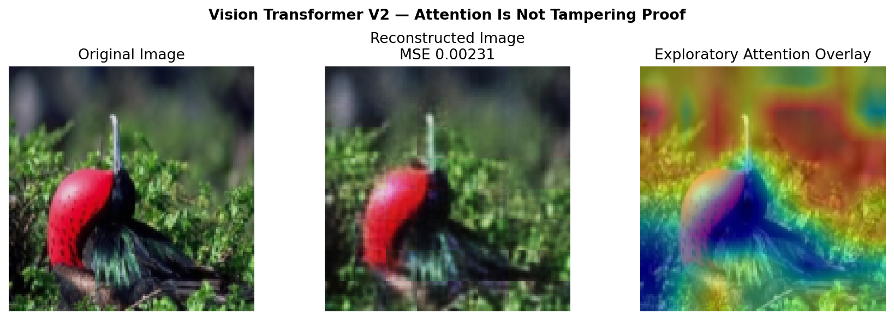

# Generative AI practical: AE, VAE, ViT and FLAN-T5 status report

**Audit date:** 25 November 2026 (India). **Practical preparation target:** 26 November 2026.

This report follows the running code and saved artifacts, rather than treating README or planning documents as authoritative. Only this report was added. No source, notebook, checkpoint, dataset, application behavior, or existing result was deliberately edited. No model was retrained. Evaluation artifacts from this audit were directed to a temporary directory, not over existing results.

## 1. Read this first

| Module | Current implementation status | What you can demonstrate | Main qualification |
|---|---|---|---|
| Autoencoder | **Completed and working for reconstruction** | Current residual Quality AE V1; preserved RTX-80 AE also loads and reconstructs | The GUI uses a newer 6x bottleneck AE, whereas AGENTS/context still require the older RTX-80 24x AE |
| VAE | **Working reconstruction and posterior sampling; partially complete scientific validation** | VAE V5 deterministic reconstruction, genuine stochastic reconstructions, difference maps | Prior generation is poor; original training split conflicts with the current evaluation split |
| Vision Transformer | **Completed and working for reconstruction/attention exploration** | ViT V2 reconstruction, patch-token features and attention | Several GUI architecture numbers and its canonical ROC-AUC row are wrong |
| FLAN-T5 | **Working pretrained integration; partially complete evaluation and long-document handling** | Real text and PDF extraction followed by local pretrained generation | Hybrid rules/model output, silent within-chunk truncation, and no reference-answer evaluation |

**Your strongest honest project description:** “We implemented and trained image reconstruction architectures and integrated a pretrained language Transformer for text/PDF assistance. Reconstruction scores measure image fidelity; these modules do not establish whether evidence is authentic.”

The root `REVIEW2_CONTEXT.md` is absent. Its full contents were read from `docs/REVIEW2_CONTEXT.md`. That document is a historical implementation plan: claims such as “no prompt/text LLM module exists,” “Transformer canonical evaluation is not yet verified,” and “VAE is a pointer locally” no longer describe this checkout.

### Evidence labels used here

- **Fresh verification:** code actually executed during this audit.
- **Saved result:** a repository JSON/CSV/notebook output, checked against the associated implementation where possible. This does not mean training was rerun or its entire provenance independently certified.
- **Inference/concern:** a conclusion drawn from code, with the uncertainty stated.
- **Unavailable:** no defensible measured result was located or the relevant experiment was not run.

## 2. Shared dataset, environment and evaluation facts

### Dataset and preprocessing

The image modules use CASIA v2.0. `results/dataset_summary.json` inventories **17,737 supported image files**, but this includes **5,123 ground-truth masks**. The actual photograph collection is **12,614 images: 7,491 authentic and 5,123 tampered**. Do not call 17,737 the training-image count.

The current manifests are:

| Manifest | Authentic | Tampered | Total |
|---|---:|---:|---:|
| `data/splits/train.csv` | 5,244 | 3,586 | 8,830 |
| `data/splits/validation.csv` | 1,124 | 768 | 1,892 |
| `data/splits/test.csv` | 1,123 | 769 | 1,892 |

Fresh inspection found every listed file present, unique paths within each split, zero path overlap between the three splits, and no ground-truth masks in these manifests. This is **path-level verification**, not proof that no near-duplicate scene or authentic source image is related to a tampered image across splits. Content/source-group leakage has not been excluded.

`src/ae_dataset.py` opens images with Pillow, converts to RGB, resizes to **128 x 128 using bilinear interpolation**, divides by 255, and produces float tensors in `[0,1]` with shape `[batch,3,128,128]`. The inference wrappers use the same basic preprocessing. There is no ImageNet normalization and no augmentation in this shared loader. Resizing can distort aspect ratios and remove fine forensic traces. “Original Image” in the GUI means the **resized model input**, not a full-resolution evidentiary original.

`src/prepare_ae_data.py` creates the current seeded, class-stratified split using Python random shuffling and rounded class counts. Do not rerun it immediately before the examination: it writes manifests and pipeline artifacts.

### Environment and checkpoint availability

Fresh environment checks: **Python 3.12.10, PyTorch 2.13.0+cpu, CUDA unavailable**. The relevant packages, including Streamlit, transformers, pypdf and scikit-image, are installed in `.venv`. Tests use Python `unittest`; pytest is absent and unnecessary for those tests.

| Active/preserved checkpoint | Actual local bytes | Loaded successfully in fresh inference? |
|---|---:|---|
| `checkpoints/best_quality_autoencoder_v1.pth` | 28,546,743 | Yes |
| `checkpoints/best_autoencoder_rtx80_portable.pth` | 1,070,083 | Yes |
| `checkpoints/VAE_V5_FINAL.pth` | 211,297,751 | Yes |
| `checkpoints/transformer_v2_final.pth` | 14,399,225 | Yes |

All four have actual model bytes, not Git LFS pointer text. `src/checkpoint_utils.py` also detects pointers and reports an actionable LFS command for other installations. A GitHub ZIP or a fresh clone can still differ from this working local checkout.

The **nonportable** `checkpoints/best_autoencoder_rtx80.pth` raised a fresh `weights_only=True` deserialization error because its metadata contains `pathlib.WindowsPath`. Use the portable file. This is distinct from a missing checkpoint or an LFS pointer; no unsafe pickle fallback was used in this audit.

FLAN-T5 weights and tokenizer files are available in the local Hugging Face cache, including a **307,867,048-byte `model.safetensors`** file. Fresh generation succeeded with `HF_HUB_OFFLINE=1` and `TRANSFORMERS_OFFLINE=1`; no paid API/key was used.

### How to interpret the metrics

| Metric | Simple explanation | Direction |
|---|---|---|
| MSE | Mean squared difference between input and reconstructed pixel values | Lower |
| PSNR | Logarithmic reconstruction quality, here `-10 log10(MSE)` for `[0,1]` pixels | Higher |
| SSIM | Structural similarity between input and reconstruction | Higher, toward 1 |
| KL | How far the learned VAE posterior is from a standard Gaussian, under the implemented reduction | Interpret alongside reconstruction and sampling |
| ROC-AUC | Ability of an error score to rank tampered images above authentic images | Around 0.5 means weak/random ranking |

Saved summary values are means of **per-image** metrics. In particular, mean PSNR is not generally equal to PSNR calculated from mean MSE. None of MSE, PSNR or SSIM is a tampering probability. FLAN-T5 text should not be compared using image reconstruction scores.

## 3. Autoencoder

### 3.1 Which AE is actually current?

There are two relevant architectures. The application default in `app.py:load_ae()` is **Quality Autoencoder V1**, from `src/quality_autoencoder.py`, using `best_quality_autoencoder_v1.pth`. The older standard model is preserved in `src/autoencoder.py` and the RTX-80 portable checkpoint.

| Property | Current GUI: Quality AE V1 | Preserved RTX-80 AE |
|---|---|---|
| Parameters | **2,371,715** | **265,571** |
| Input/output | RGB 128 x 128 | RGB 128 x 128 |
| Latent tensor | 32 x 16 x 16 = 8,192 values | 32 x 8 x 8 = 2,048 values |
| Value-count reduction | 6x | 24x |
| Encoder-to-decoder bypass | None | None |
| Decoder | Bilinear upsampling plus convolutions/residual blocks | Transposed convolutions |
| Output activation | Sigmoid | Sigmoid |
| Selected checkpoint epoch | 79 | 76 |

These ratios count floating-point values; they are **not measured file compression ratios** against JPEG or PNG. Actual storage also depends on numerical precision, headers and model weights.

**Status:** both models work. The repository policy conflict is real: AGENTS/context say RTX-80 is final, while the running app and comparison artifacts use Quality AE. This report does not change either. Explain the two versions explicitly; do not describe the active residual AE using the old architecture.

### 3.2 Architecture and working principle

An AE learns to reconstruct its input: `x -> encoder -> z -> decoder -> x_hat`. The target is the image itself, so class labels are not reconstruction targets.

Current Quality AE encoder: initial 5x5 convolution `3 -> 48`, SiLU and a residual block; three downsampling stages `48 -> 64 -> 96 -> 128`; additional residual blocks; 1x1 projection to 32 channels. Spatial dimensions become `128 -> 64 -> 32 -> 16`. The latent has no final nonnegative constraint. Decoder input maps `32 -> 128`, then residual processing and resize-convolution stages `128 -> 96 -> 64 -> 48`, followed by a residual block, 5x5 RGB output convolution and Sigmoid.

A residual block adds its input to its learned two-convolution transformation. These **internal residual connections** are different from passing high-resolution encoder features directly to the decoder. Quality AE has no such bottleneck bypass.

The RTX-80 model uses four stride-2, 4x4 convolutions with channels `3 -> 32 -> 64 -> 64 -> 32` and ReLU, mirrored by four transposed convolutions and final Sigmoid. It is smaller and compresses more aggressively, but reconstructs less clearly.

### 3.3 Objective and training settings

| Setting | Quality AE: code/checkpoint verified | RTX-80: checkpoint configuration verified |
|---|---|---|
| Objective | `0.65 L1 + 0.25 (1 - SSIM) + 0.10 edge_loss` | MSE |
| Edge term | Average of L1 errors in horizontal/vertical pixel differences | Not used |
| Optimizer | AdamW | AdamW in `train_autoencoder_v2.py` |
| Initial learning rate | 0.0003 | 0.001 |
| Weight decay | 0.00001 | 0.000001 |
| Batch size / seed | 32 / 42 | 32 / 42 |
| Epochs completed | 80 | 80 |
| Selection | Highest validation SSIM, with configured improvement threshold | Lowest validation MSE |
| Scheduler | ReduceLROnPlateau, mode=max, factor=0.5, patience=4, minimum LR=0.000001 | Mode=min, factor=0.5, patience=3, minimum LR=0.000001 |
| Early-stop patience | 12; not triggered | Configured 12; history contains all 80 epochs |

Sources: `src/train_quality_autoencoder.py`, checkpoint `config`, `results/quality_ae_v1_training_summary.json`, and both training-history CSVs. Training SSIM uses the differentiable torchmetrics implementation; evaluation uses scikit-image. Their values need not match exactly.

### 3.4 Saved training and evaluation results

Quality AE trained on a **Tesla T4** according to the saved summary, for **4,367.66 seconds**. Its history has 80 rows. Validation MSE fell from **0.01828152** at epoch 1 to **0.00095435** at epoch 80, and validation SSIM rose from **0.573371** to **0.942450**. Epoch **79** was selected by validation SSIM **0.94267369**, with validation MSE **0.0009579012**. Epoch 80 having slightly lower MSE does not make selection wrong: SSIM was the selection metric.

| Saved evaluation on current 1,892-image test manifest | MSE | PSNR (dB) | SSIM |
|---|---:|---:|---:|
| Quality AE V1 | 0.0009460259 | 31.195080 | 0.93865384 |
| RTX-80 | 0.0030319858 | 26.015853 | 0.79291059 |

Source files: `results/quality_ae_v1_test_metrics.json` and `results/ae_rtx80_test_metrics.json`. Fresh recomputation of their per-image CSV means matched the saved summaries. Their CSV paths match the current test manifest.

**Fresh single-image inference:** `Au_ani_00004.jpg` produced Quality AE MSE **0.0010157566**, PSNR **29.932103 dB**, SSIM **0.94606096**. RTX-80 on the same image produced MSE **0.0032624146**, PSNR **24.864608 dB**, SSIM **0.79627734**. These are individual-image results, not new population averages.

### 3.5 Actual images and graphs





Both images were visually inspected. The bird retains shape and color; the tampered landscape also reconstructs well, with smoothing of detail. That is expected for reconstruction and demonstrates why a low error cannot establish authenticity. The training curves show steady learning, without an obvious large train/validation divergence in the recorded objective.

Other available artifacts: `docs/results/quality_ae_test_reconstructions.png`, `docs/results/quality_ae_validation_reconstructions.png`, `outputs/ae_rtx80/test_reconstruction_grid.png`, and `outputs/ae_rtx80/training_curve.png`. The RTX-80 graph has generic “AE V2”/“Fine-tuning epoch” labeling, despite its checkpoint recording fresh 80-epoch training (`initial_checkpoint=None`); explain from metadata instead of repeating that axis label.

### 3.6 Strengths, issues and improvements

**Good:** working strict checkpoint loading, matching preprocessing, real test metrics, a true bottleneck without decoder bypass, improved fidelity, a differentiable structure/edge-aware objective, and a working GUI demo gallery.

| Priority | Issue / improvement | Why it matters |
|---|---|---|
| Before exam | Decide how to explain Quality AE versus the policy-required RTX-80 baseline | Mixing their sizes, losses or results is a likely viva mistake |
| Before exam | Avoid the nonportable RTX-80 checkpoint; use the portable file | Modern safe loading currently rejects the original metadata |
| Before exam | Do not use `Autoencoder_CASIA_Complete_Demo.ipynb` as evidence for the current Quality AE | It loads `best_autoencoder.pth`, the old epoch-42 baseline |
| Before exam | Reject the GUI’s AE ROC-AUC “0.498” claim | Recalculation from the saved Quality AE CSV gives **0.53669752**, not 0.498 |
| Later | Evaluate compression-quality tradeoffs at matched bottleneck size | Quality AE has more parameters and four times as many latent values as RTX-80 |
| Later | Verify image-content/source-group overlap across splits | Path separation alone does not establish independence |

`02_autoencoder_training_colab.ipynb` contains a separate **40-epoch RTX-80 fine-tuning** run reporting MSE **0.00300525**, PSNR **26.06371**, SSIM **0.79454674**. Its corresponding fine-tuned checkpoint is not in the active checkpoints directory, so these are notebook-reported historical results, not the current model. `Autoencoder123.ipynb` contains another old 100-epoch run; do not merge that log with the current baseline checkpoint metadata. `04_quality_autoencoder_training_colab.ipynb` is the relevant executed Quality AE training notebook, but it performs training and should not be run wholesale during the examination.

### 3.7 Examination demonstration and viva points

Launch the shared GUI using section 7, choose **Autoencoder**, give processing consent, select **Canonical test demo**, and choose an image. The current GUI uses Quality AE automatically and displays real inference metrics. `src/ae_inference.py` is the loading/preprocessing/inference entry point.

For an explicitly requested RTX-80 demonstration, use the load-only Python example in section 7. Avoid changing only `AE_CHECKPOINT_PATH` in the GUI: reconstruction would switch, but hard-coded Quality AE architecture labels and saved metric cards would remain.

Be ready to explain: deterministic versus stochastic output; why the target is the input; encoder, latent and decoder; why Sigmoid matches `[0,1]`; internal residual connections; 6x versus 24x value-count compression; why high similarity is not forgery detection; and why reducing the bottleneck less aggressively can improve reconstruction.

## 4. Variational Autoencoder: VAE V5 Final

### 4.1 Architecture and working principle

Current implementation: `src/vae.py:VAEV5`; loader: `src/vae_inference.py:VAEInference`; checkpoint: `checkpoints/VAE_V5_FINAL.pth`. It has **17,599,971 parameters**, verified by the architecture/artifact records and strict loading.

The encoder downsamples `3x128x128 -> 32x64x64 -> 64x32x32 -> 128x16x16 -> 256x8x8`, using stride-2 convolutions, GroupNorm, SiLU and residual blocks. The flattened 16,384 features feed **two separate linear heads**, each producing 256 values: `mu` and `logvar`.

The encoder therefore predicts a diagonal Gaussian distribution for each image:

```text
std = exp(0.5 * logvar)
epsilon ~ Normal(0, I)
z = mu + temperature * std * epsilon
```

This is the reparameterization trick: randomness is isolated in epsilon, so gradients can flow through mu and std during training. A deterministic evaluation uses `z = mu`; training `forward()` samples z.

The decoder expands z to `256x8x8`, applies convolution/residual blocks, bilinear upsampling, and concatenates encoder skip tensors e3, e2 and e1. It ends in an RGB convolution and Sigmoid. e4 is accepted by the decode API but intentionally unused; this mirrors the source architecture rather than constituting a missing weight.

**Important distinction:** the 256-dimensional z is not the decoder’s only information source. Image-specific skip tensors also reach the decoder. Do not claim the whole reconstructed image is recovered solely from 256 stored numbers or compare it as pure 192x compression against the AE.

### 4.2 Loss and training settings

```text
reconstruction = 0.5 * mean_squared_error + 0.5 * mean_absolute_error
KL = -0.5 * mean_over_batch(sum_over_latent(1 + logvar - mu^2 - exp(logvar)))
total = reconstruction + beta * KL
```

| Setting | Verified source value |
|---|---|
| Latent dimension / image size | 256 / 128 |
| Optimizer | AdamW in original V5 notebook |
| Initial LR / weight decay | 0.0001 / 0.00001 |
| Batch / seed | 32 / 42 |
| Epochs | Fixed 80; no early stopping in V5 source training |
| KL warm-up | Beta 0.00005 to 0.00030 over 20 epochs |
| Gradient clipping | Norm 1.0 |
| LR scheduler | ReduceLROnPlateau on validation MSE, factor 0.5, patience 5, minimum LR 0.000001 |
| Selection | Lowest validation MSE; saved epoch 79 |

V5 training is in the archived experiment notebooks, especially `bin/notebooks/VAE_experiments/VAE_V5_External_Tampered_vs_Authentic.ipynb`. Its final export cell copies **mixed-data `best_vae_v5.pth`** to `VAE_V5_FINAL.pth`. Authentic-only forensic variants elsewhere in that notebook/archive are separate experiments. The generic `src/train_vae.py` and `src/train_vae_v2.py` train the legacy architecture, not this V5 model. There is no clean dedicated current V5 training CLI under `src/`; that is a reproducibility gap, not an inference blocker.

### 4.3 Training/evaluation results and a serious split qualification

`results/vae_v5_final_training_history.csv` has 80 rows, with rounded historical values. Epoch 1 reports training MSE **0.01207**, validation MSE **0.00662**, validation KL **1.0586**. Epoch 80 reports **0.00057**, **0.00099**, and **0.0095** respectively. The exact checkpoint epoch-79 metadata gives validation MSE **0.0009786994**, validation PSNR **30.09350675 dB**, L1 **0.0207429743**, KL **0.0086780446**, beta **0.0003**. Exact total training time is not available in the current final-history CSV.

Saved current-manifest evaluation (`results/vae_v5_final_test_metrics.json`):

| Measure | Saved value |
|---|---:|
| Images | 1,892: 1,123 authentic + 769 tampered |
| Deterministic MSE | 0.0007000721 |
| Mean PSNR | 32.95345649 dB |
| Mean SSIM | 0.96113885 |
| Mean KL | 0.01292955 |
| Mean hybrid reconstruction loss | 0.0088957505 |
| Mean total loss | 0.0088996294 |
| Exploratory MSE ROC-AUC | 0.51538177 |
| Exploratory SSIM-error ROC-AUC | 0.57055803 |
| Final V5 FID | **Unavailable / null** |

Fresh recomputation of the per-image CSV means matches this JSON. Its paths are absolute Windows paths, whereas AE/ViT CSVs use relative paths; matching image basenames yields the same 1,892 current-manifest images. The difference is path serialization, not a different evaluated image list.

**However, calling this VAE evaluation genuinely held out is unsafe.** The original final-export notebook creates a different split: **8,829 training / 1,892 validation / 1,893 testing**, using a pandas shuffle and sklearn stratified splits. Saved notebook output confirms those counts. Reconstructing that exact split algorithm from the current sorted CASIA image lists with seed 42 found the following overlap with the current 1,892-image comparison set:

| Current evaluation images belonging to reconstructed original V5 split | Count |
|---|---:|
| Original training | **1,317** |
| Original validation | **295** |
| Original test | **280** |

These are **fresh reconstructed membership counts**, not a recovered immutable training manifest. The final checkpoint does not embed training-manifest hashes, so byte-for-byte training provenance remains unproven. Nevertheless, the matching source/export path, split outputs and algorithm provide strong evidence of evaluation contamination. The metrics are real reconstruction measurements, but they must not establish unbiased VAE superiority or unseen-image generalization. Equal evaluation image counts do not fix training exposure.

Recommended resolution: recover the original split manifests and evaluate on verified unseen samples or a common set unseen by every checkpoint. A full retrain is not needed simply to demonstrate inference tomorrow. Treat rebuilding a rigorously shared train/validation/test experiment as later work if necessary.

### 4.4 Fresh stochastic-behavior checks

`reconstruct_variations()` uses learned mu/logvar and the same image’s skip tensors for every decode; it does not edit pixels to fake variation. Fresh tests used three samples and seed 42:

| Image | Temperature | Mean absolute pixel differences from deterministic reconstruction |
|---|---:|---|
| `Au_ani_00004.jpg` | 0 | 0, 0, 0 |
| `Au_ani_00004.jpg` | 1 | 0.00025916, 0.00039066, 0.00042970 |
| `Au_ani_00004.jpg` | 2 | 0.00024563, 0.00040950, 0.00043779 |
| `Au_ani_00027.jpg` | 1 | 0.00212390, 0.00211691, 0.00171567 |
| `Au_ani_00027.jpg` | 2 | 0.00217412, 0.00220902, 0.00178734 |

At temperature zero, stochastic outputs equal deterministic output exactly in this test. Nonzero temperatures change the latent and reconstruction genuinely, but changes remain small and image-dependent. Doubling temperature does not guarantee doubling pixel changes because the decoder is nonlinear and uses strong skips. For image 00027, temperature-2 latent distances from mu were approximately **31.65, 30.50, 33.67**, despite subtle output changes.

A fresh prior sample with zero skips had pixel mean **0.02960** on `[0,1]`, supporting the visibly dark generation limitation. This is one sample, not a population quality measurement.

### 4.5 Actual outputs, strengths and improvements




Both were visually inspected. The stochastic images are very similar; their separately scaled difference maps reveal small actual changes. Bright map colors do not imply large absolute pixel changes or tampering. Prior-only outputs are dark and lack meaningful scene structure. `outputs/vae_v5_final/reconstruction_grid.png`, `authentic_vs_tampered_error.png` and `roc_curves.png` are the relevant final artifacts. Earlier `outputs/vae/` plots correspond partly to legacy V1/V2 experiments and should not be presented as V5 training curves.

**Good:** mathematically correct posterior sampling, stable deterministic reconstruction, genuine uncertainty controls, strict loading, explicit limitations, and strong numerical reconstruction on the evaluated collection.

| Priority | Improvement | Reason |
|---|---|---|
| Before exam | State the training/evaluation split contamination concern | Current reconstruction scores are reproducible but their held-out interpretation is compromised |
| Before exam | Use image 00027, seed 42 and temperature 2; show numeric differences | This honestly demonstrates a stronger known posterior response without claiming dramatic changes |
| Before exam | Explain prior-only weakness and decoder skips | Strong reconstruction does not imply good unconditional generation |
| Later | Add population-level latent sensitivity and posterior-collapse diagnostics | Two example images do not establish healthy latent usage across the dataset |
| Later | Train a separate variant with controlled skip dropout/weaker skips and carefully tuned KL | Encourage decoder dependence on z while preserving the working checkpoint |
| Later | Extract the V5 trainer and immutable split provenance into a reproducible module | Legacy training CLIs do not reproduce V5, and `bin/` is ignored |

Do not call low mean KL conclusive proof of complete posterior collapse: the fresh latent perturbations do affect output. It does motivate deeper checks alongside the small variations and weak prior generation.

### 4.6 Demonstration and viva points

GUI: **Variational Autoencoder -> Probabilistic reconstructions -> consent -> Canonical test demo**. Choose 00027 if available in the selector; otherwise upload `data/raw/CASIA2/Au/Au_ani_00027.jpg`. Use temperature **2.0**, seed **42**, and explain deterministic output, three samples and color-bar scales. The **Prior-only limitation** tab deliberately demonstrates the known weakness.

Load-only notebook: `notebooks/VAE/VAE_CASIA_Complete_Demo.ipynb`. It uses the final checkpoint, though full posterior-variation controls are more directly available in the GUI.

Know mu versus log variance; why `exp(0.5*logvar)` is standard deviation; reparameterization; reconstruction/KL tradeoff; beta warm-up; posterior versus prior samples; deterministic evaluation; skip bypasses; GroupNorm versus batch-dependent normalization; and the distinction between learned probabilistic variation and newly discovered evidence.

## 5. Vision Transformer V2

### 5.1 Status and architecture

Current source: `src/transformer.py:TransformerForensicAutoencoder`; loader: `src/transformer_inference.py`; checkpoint: `checkpoints/transformer_v2_final.pth`. Strict loading and fresh image reconstruction worked. **Actual parameter count: 3,591,168.** The GUI’s **2,139,139** count is wrong; the older notebook/checkpoint with **5,677,056** parameters is a different model.

```text
128x128 RGB
 -> Conv2d patch projection, kernel=stride=16
 -> 64 tokens, each 256-dimensional
 -> learned positional embeddings
 -> 4 encoder self-attention blocks
 -> all 64 encoded tokens + decoder positions
 -> 2 additional self-attention blocks
 -> linear projection to 16x16x3 patch values
 -> reassemble image -> Sigmoid
```

Each block uses pre-LayerNorm, eight-head self-attention, residual additions, a `256 -> 512 -> 256` GELU feed-forward network, and dropout **0.1**. Head dimension is **32**. A separate mean-pooling/LayerNorm branch returns a **256-D global feature vector**.

**Critical viva detail:** reconstruction consumes **all encoded patch tokens**, not just the pooled 256-D feature. The two blocks named “decoder” use self-attention; this image decoder has no separate encoder-decoder cross-attention or causal language mask. It is nevertheless a valid Transformer architecture. There is no CLS token in this implementation.

The attention map averages final-layer attention across query tokens; PyTorch’s returned weights are already averaged across heads by default. The resulting 64 scores are reshaped to **8x8** and min-max normalized for display. It is an exploratory average attention visualization, not attention rollout or a validated tampering mask.

### 5.2 Dataset, loss and training

The executed V2 training notebook is the long-named `notebooks/Transformer/Multi_Model_Generative_AI_Framework_for_Digital_Evidence_Analysis_and_Intelligence_Generation.ipynb`. It uses CASIA images sorted by path and seed-42 shuffling, with **authentic-only training**, **authentic-only validation**, and all tampered images reserved for testing.

Reconstructing its source split with supported image extensions gives **5,243 training authentic**, **1,123 validation authentic**, and **6,248 original test images** (1,125 authentic + all 5,123 tampered). Fresh membership checking found **all current 1,892 evaluation images inside that original test set**, with **zero current-test path overlap with reconstructed ViT training/validation**. This supports ViT’s current held-out interpretation at image-path level. Its training policy still differs from mixed-data AE/VAE; acknowledge this in comparisons.

| Setting | Value from V2 source notebook/checkpoint |
|---|---|
| Objective | Pixel MSE |
| Optimizer / initial LR | AdamW / 0.0001 |
| Weight decay | 0.00001 |
| Batch / epochs | 64 / 50 |
| Scheduler | ReduceLROnPlateau, factor 0.5, patience 5, minimum LR 0.000001 |
| Gradient clipping | Norm 1.0 |
| Model selection | Lowest validation MSE |
| Seed | 42 for split; complete cross-device training determinism is not established |

The current `src/` folder contains the architecture and evaluation but no standalone V2 training CLI. Training remains notebook-based.

### 5.3 Results

`results/transformer_v2_training_history.csv` has 50 rows, from train/validation MSE **0.04283 / 0.023442** at epoch 1 to **0.002569 / 0.002060** at epoch 50. The rounded history matches exact checkpoint final train MSE **0.0025685047** and validation MSE **0.0020600450**. Full training duration is not recorded in this CSV.

| Saved canonical evaluation, 1,892 images | Value |
|---|---:|
| MSE | 0.0022073263 |
| PSNR | 27.26518617 dB |
| SSIM | 0.84486399 |
| Exploratory canonical MSE ROC-AUC | **0.54129926** |
| Saved total evaluation time | 50.8616 s on CPU |
| Saved model-forward time | 13.4548 s |

Sources: `results/transformer_v2_test_metrics.json` and matching per-image CSV, whose means and test paths were checked afresh.

The checkpoint’s earlier ROC-AUC **0.54553426**, threshold **0.0044039055**, and balanced accuracy **0.51895409** are separate original-evaluation metadata. The GUI incorrectly repeats **0.5455** in a table described as canonical-test ROC-AUC. Its canonical value is **0.5413**. Both indicate weak separation. The threshold is a reference reconstruction-error threshold, not a calibrated probability.

Fresh individual bird-image reconstruction produced MSE **0.0023113647**, PSNR **26.361315 dB**, SSIM **0.84911221**, a 256-D feature vector and an **8x8** attention map.

### 5.4 Actual output, strengths and improvements



The inspected image shows preserved bird shape/color with more smoothing than the current Quality AE example. The heatmap is coarse and includes background structure; it should not be read as a location-of-forgery result. The full saved grid is `outputs/transformer_v2/test_reconstruction_grid.png`; training/evaluation/attention plots are also embedded in `notebooks/Transformer/Transformer_CASIA_Complete_Demo.ipynb`.

**Good:** genuine patch-token attention, learned spatial position, retention of all spatial tokens for reconstruction, strict checkpoint compatibility, a working load-only demo notebook, a canonical evaluation script, and real visualizations.

| Priority | Improvement | Reason |
|---|---|---|
| Before exam | Use **3,591,168** parameters and canonical AUC **0.5413** | GUI architecture/comparison tables contain stale hard-coded values |
| Before exam | Explain all-token reconstruction versus pooled feature output | Avoid falsely describing a 256-value reconstruction bottleneck |
| Before exam | Distinguish original authentic-only training/test from current canonical evaluation | They have different counts and purposes |
| Later | Keep training manifests/checksum and extract notebook training into a script | Improves reproducibility and provenance |
| Later | Evaluate patch size, decoder capacity and losses under a fixed protocol | Lower fidelity is measurable, but architectural changes need controlled evidence |
| Later | Validate any proposed localization against masks and independent cases | Attention alone does not establish localization quality |

Do not claim that poorer MSE proves a deliberate trade for better forensic accuracy; no reliable accuracy benefit has been established here.

### 5.5 Demonstration and viva points

GUI: **Transformer -> Vision Transformer tab -> consent -> Canonical test demo**. Show original, reconstruction, MSE/PSNR/SSIM and attention overlay. Load-only notebook: `notebooks/Transformer/Transformer_CASIA_Complete_Demo.ipynb`. Avoid running the original training notebooks wholesale: one older notebook also writes split files and trains a different architecture.

Explain patches as tokens, position embeddings, Q/K/V, `softmax(QK^T/sqrt(d_k))V`, eight heads, LayerNorm, residual paths, feed-forward layers, global attention versus convolution, self-attention versus cross-attention, and the quadratic token-pair attention cost. A ViT can be a generative reconstruction model without being a text LLM.

## 6. FLAN-T5 evidence Transformer

### 6.1 Status, architecture and model ownership

`src/evidence_transformer.py` integrates **pretrained `google/flan-t5-small`** with `AutoTokenizer` and `AutoModelForSeq2SeqLM`. `src/document_parser.py` handles TXT/PDF extraction. It is a local pretrained integration, with **no project training/fine-tuning**, optimizer or local training loss history. Do not claim the team trained this language model.

Fresh inspection of the loaded model configuration verified:

| Property | Actual FLAN-T5-small value | Incorrect GUI theory claim |
|---|---:|---|
| Parameters | **76,961,152** | Parameter count is correct |
| Hidden dimension | **512** | Correct |
| Encoder / decoder blocks | **8 / 8** | Says 6 / 6 |
| Attention heads | **6** | Says 8 |
| Feed-forward dimension | **1,024**, gated GELU | Not clearly specified |
| Model vocabulary matrix | **32,128** entries | Says 32,100 |
| Position representation | Relative attention bias | Broadly correct |

The tokenizer uses SentencePiece subword tokenization; the GUI’s “SentencePiece subword BPE” wording is imprecise and should be replaced with the actual tokenizer description. Avoid conflating tokenizer vocabulary conventions with the padded model embedding-matrix size.

The encoder attends over input tokens; the decoder uses causal self-attention and cross-attention to encoder states, generating tokens autoregressively. Its pretrained language objective is sequence cross-entropy, but **no local training objective was optimized in this repository**.

### 6.2 Inputs, preprocessing, prompts and generation

Supported inputs: pasted text, UTF-8/UTF-8-BOM `.txt`, and digitally extractable `.pdf`, with uploaded files limited to **10 MiB**. Parsing is in memory. PDF extraction uses pypdf; empty, malformed, password-protected and scanned/image-only documents receive actionable errors. **OCR is not implemented.** No labeled text-evaluation dataset or gold reference summaries were found.

The default five-line analyst prompt asks for a summary, preservation of identifiers, cautious treatment of conflicts, separation of fact/inference, and no guilt/authenticity/legal verdict. A GUI help string calls it six lines, another small inconsistency.

`EvidenceTransformer` defaults to **512 input tokens**, up to **8 chunks**, payload size computed from prompt tokens and a fixed framing reserve, and overlap up to **32 tokens**. It processes chunks separately and concatenates chunk-specific outputs; it does not perform a final cross-chunk synthesis pass. The GUI’s “up to 2,048 tokens total” description is not the code’s actual fixed capacity.

Generation uses **two beams**, `do_sample=False`, `no_repeat_ngram_size=3`; the default output budget is **192 newly generated tokens per chunk**. The public API accepts 32–512; the GUI slider exposes 64–384. The model ID can be overridden using `EVIDENCE_MODEL_ID`, including a compatible local model directory. Streamlit caches loading.

### 6.3 What the generated report actually contains

This is a **hybrid pipeline**:

1. FLAN-T5 generates the summary text.
2. Python regexes extract candidate names, dates, times, identifiers, hash-like strings and email addresses.
3. Rules add cautious observations and relevance text.
4. A fixed limitations/responsible-use note is appended.

The implementation and current output disclose that distinction. Do not describe all entities, conflict detection or five report sections as neural generation. Regex extraction is not named-entity recognition validated on a dataset. Pattern matches can be wrong, incomplete or case/language dependent.

The demo’s `SHA-256 abc123` is a short synthetic hash-like string, **not a valid complete SHA-256 digest**. The regex accepts such short examples; it is not a cryptographic hash validator.

### 6.4 Actual fresh text and PDF output

The saved demonstration is `docs/results/evidence_transformer_demo.md`, with provenance/metadata in `docs/results/artifact_manifest.json`. Fresh offline generation reproduced its output from this synthetic input:

> At 09:15 on 12 March 2026, analyst Mira Patel collected device EX-17. The transfer log records SHA-256 abc123. A later note states that collection began at 10:15, but no timezone is recorded.

**Fresh model-generated summary:**

> At 09:15 on 12 March 2026, analyst Mira Patel collected device EX-17. The transfer log records SHA-256 abc123.

**Actual added indicator section:** Mira Patel, 12 March 2026, 09:15, 10:15, EX-17, SHA-256 abc123.

**Actual added observation:** “Multiple distinct time references appear (09:15, 10:15). Verify whether they describe the same event and use the same time zone before treating them as inconsistent.” The output also notes absent time-zone context and quotes the source’s contrasting sentence. These observations come from source-pattern logic, not proof that FLAN-T5 independently reasoned about the conflict.

The fixed note reads:

> Research/educational use only. Verify every observation against the original evidence. Generated text may contain errors and must not be used as the sole legal or forensic basis.

| Test | Input evidence tokens | Final formatted output tokens | Chunks | Fresh generation time |
|---|---:|---:|---|---:|
| Pasted synthetic text | 52 | 359 | 1 / 1 | 8.8613 s |
| Same text extracted from a one-page in-memory PDF | 52 | 359 | 1 / 1 | 5.4386 s |
| Previously saved demo | 52 | 359 | 1 / 1 | 5.4172 s, historical CPU run |

Fresh runs used `max_new_tokens=128`. **359 output tokens does not mean the model generated 359 tokens:** `output_tokens` counts the entire formatted report, including rule-derived text and fixed notices. Timings vary with machine load and exclude initial model loading. There is no verified ROUGE, BLEU, factual accuracy, hallucination-rate or forensic-case benchmark. The GUI’s **“0 hallucinated patterns via extraction constraints”** is an unsupported evaluation claim.

### 6.5 Verified bug: token accounting and silent truncation

The chunk payload calculation reserves **48 tokens** for framing, but the actual generation request includes more instruction/marker text. A fresh tokenizer check using repeated demonstration evidence measured:

| Quantity | Measured value |
|---|---:|
| Evidence payload in first chunk | 378 tokens |
| Actual complete request | **537 tokens** |
| Configured input limit | **512 tokens** |

`_generate_text()` calls the tokenizer with `truncation=True`, so this request is truncated silently. The returned `truncated` flag only tracks dropping chunks beyond `max_chunks`, not within-request truncation. `processed_tokens` counts chunk lengths before truncation and includes overlap, so it can overstate actual unique evidence processed. For one chunk, regex indicators use the full original text even if the model did not see all of it. The exact lost content depends on tokenization and prompt length.

**Recommended fix, later and with regression tests:** tokenize the exact full request when allocating each chunk; reserve space based on that framing; record actual retained evidence/unique token coverage; report both kinds of truncation; and keep output accounting separate for neural generation and formatting. Use short evidence tomorrow until this is corrected.

### 6.6 Strengths and remaining improvements

**Good:** actual pretrained generation, CPU/offline-cache operation, no required API key, separate text and image Transformers, in-memory document parsing, model-load failure messages, input validation, and a clear responsible-use boundary. Fresh AppTest confirmed the GUI Generate action produces an Evidence Summary without an application error.

| Priority | Improvement | Why |
|---|---|---|
| Before exam | Use short synthetic text and a short digital PDF | Both paths were verified; avoids the known long-chunk defect |
| Before exam | Explain hybrid model/rule output and formatted token counts | Prevents overstating neural reasoning or generation throughput |
| Before exam | Correct your spoken architecture to 8+8 blocks, 6 heads | The GUI theory table is factually wrong |
| Before exam | Avoid “zero hallucinations” and invented text accuracy | No benchmark supports those claims |
| Later | Fix exact prompt-budget/truncation accounting | Otherwise long evidence can be omitted without the advertised warning |
| Later | Build an annotated set with identifier preservation, omission and unsupported-claim checks | A single successful example is not a quality evaluation |
| Later | Test adversarial evidence instructions, multilingual inputs and large PDFs | Instruction delimiters and size checks are useful but not a proven security boundary |
| Later | Pin tested dependency/model revisions | Broad transformers range already emits a tied-weight configuration warning during loading |

A fresh transformers load warned that configured shared/lm-head tying disagrees with the checkpoint tensors and left the weights untied. Inference still succeeded. Do not manually tie or replace weights just to suppress the warning before the exam; first investigate against the tested version/model revision.

### 6.7 Demonstration and viva points

GUI: **Transformer -> Text/PDF Evidence Intelligence tab -> consent -> paste the short example -> review Analyst prompt -> Generate evidence intelligence**. Then upload a short digitally extractable PDF if prepared. Scanned PDFs require OCR outside the current implementation.

Explain pretrained versus project-trained; encoder-decoder versus decoder-only models; tokens versus words; attention versus rule extraction; beam search versus random sampling; relative positions; context budget; model-loading cache; and why a fluent answer can still omit or invent facts. The app integrates two modalities as separate flows; it does not fuse image embeddings with document tokens in one jointly trained model.

## 7. Exact practical commands and files

Run PowerShell from the project root. The existing environment was used successfully; avoid upgrading dependencies on examination morning.

```powershell
Set-Location 'C:\Users\Chetanraje\Desktop\GAA\Digital_Evidence'
$env:PYTHONDONTWRITEBYTECODE = '1'
$env:HF_HUB_OFFLINE = '1'
$env:TRANSFORMERS_OFFLINE = '1'
.\.venv\Scripts\python.exe -B -m streamlit run app.py
```

Open the local URL printed by Streamlit. Offline flags assume the cached model files verified on this computer; they do not make an uncached new laptop work offline. Model loading uses CPU automatically here.

| Demonstration | Required files | Recommended interface |
|---|---|---|
| Current AE | `src/quality_autoencoder.py`, `src/ae_inference.py`, `best_quality_autoencoder_v1.pth` | Autoencoder page |
| RTX-80 baseline | `src/autoencoder.py`, `src/ae_inference.py`, `best_autoencoder_rtx80_portable.pth` | Load-only command below |
| VAE | `src/vae.py`, `src/vae_inference.py`, `VAE_V5_FINAL.pth` | Variational AE page; final load-only notebook |
| ViT | `src/transformer.py`, `src/transformer_inference.py`, `transformer_v2_final.pth` | Transformer/ViT tab; final load-only notebook |
| FLAN-T5 | `src/document_parser.py`, `src/evidence_transformer.py`, local tokenizer/model cache | Transformer/Text-PDF tab |
| Shared | `app.py`, `src/checkpoint_utils.py`, manifests, result files, actual CASIA images | Root-based launch |

The GUI gallery chooses the first 12 available test images from each class: **24 total**, satisfying the requested approximate 20–25 demo samples. `sample_images/` contains 32 authentic images for other uses; do not assume it is a balanced held-out gallery.

### Load-only RTX-80 demonstration

This prints metrics without changing application labels or writing image outputs:

```powershell
@'
import sys
from pathlib import Path
sys.path.insert(0, str(Path('src').resolve()))
import torch
from PIL import Image
from ae_inference import AutoencoderInference
model = AutoencoderInference('checkpoints/best_autoencoder_rtx80_portable.pth', torch.device('cpu'))
image = Image.open('data/raw/CASIA2/Au/Au_ani_00004.jpg').convert('RGB')
original, reconstruction, metrics = model.reconstruct(image)
print('Architecture:', model.architecture)
print('Output:', reconstruction.shape, 'Metrics:', metrics)
'@ | .\.venv\Scripts\python.exe -B -
```

For notebook display without retraining:

```powershell
.\.venv\Scripts\python.exe -B -m jupyter notebook notebooks/VAE/VAE_CASIA_Complete_Demo.ipynb
# Or:
.\.venv\Scripts\python.exe -B -m jupyter notebook notebooks/Transformer/Transformer_CASIA_Complete_Demo.ipynb
```

The standard AE complete-demo notebook is historical, as explained above. Starting a Jupyter server was not separately tested during this audit; its notebook code and saved outputs were inspected.

### Optional rerun of existing evaluation scripts, without overwriting saved results

These commands intentionally route new outputs to a new temporary directory. They evaluate, not train. The current VAE split qualification still applies. Full evaluation is unnecessary during the live practical; use the GUI for a quick example.

```powershell
$auditDir = Join-Path ([System.IO.Path]::GetTempPath()) ('genai_practical_' + [guid]::NewGuid().ToString('N'))
New-Item -ItemType Directory -Path $auditDir | Out-Null

.\.venv\Scripts\python.exe -B src/evaluate_autoencoder.py --num-workers 0 --batch-size 16 --checkpoint-path checkpoints/best_quality_autoencoder_v1.pth --metrics-json "$auditDir/ae.json" --per-image-csv "$auditDir/ae.csv" --reconstruction-grid "$auditDir/ae.png" --mse-plot "$auditDir/ae_mse.png" --ssim-plot "$auditDir/ae_ssim.png"

.\.venv\Scripts\python.exe -B src/evaluate_vae.py --num-workers 0 --batch-size 16 --checkpoint-path checkpoints/VAE_V5_FINAL.pth --metrics-path "$auditDir/vae.json" --per-image-path "$auditDir/vae.csv" --grid-path "$auditDir/vae.png" --error-plot-path "$auditDir/vae_error.png" --roc-plot-path "$auditDir/vae_roc.png" --generated-path "$auditDir/vae_prior.png"

.\.venv\Scripts\python.exe -B src/evaluate_transformer_v2.py --num-workers 0 --batch-size 16 --checkpoint-path checkpoints/transformer_v2_final.pth --metrics-json "$auditDir/vit.json" --per-image-csv "$auditDir/vit.csv" --reconstruction-grid "$auditDir/vit.png"
```

The AE command can evaluate RTX-80 by changing only its checkpoint argument to the portable checkpoint, while retaining distinct temporary output paths. Do not run evaluator defaults casually: their defaults overwrite canonical result files. Do not invoke `--run-fid` merely for tomorrow’s demo; final-V5 FID is currently unavailable and computing it is a separate distribution-evaluation task.

`src/smoke_review2.py` now also exercises out-of-scope GAN/diffusion services. It is not the narrowest three-model pre-exam check. This audit directly exercised the requested wrappers and selected tests instead.

### Relevant test commands

```powershell
.\.venv\Scripts\python.exe -B -m unittest discover -s tests -p test_checkpoint_utils.py -v
.\.venv\Scripts\python.exe -B -m unittest discover -s tests -p test_document_parser.py -v
.\.venv\Scripts\python.exe -B -m unittest discover -s tests -p test_evidence_transformer.py -v
.\.venv\Scripts\python.exe -B -m unittest discover -s tests -p test_quality_autoencoder.py -v
.\.venv\Scripts\python.exe -B -m unittest discover -s tests -p test_train_autoencoder_v2.py -v
```

## 8. Fresh validation record and overall comparison

Fresh checks completed: AST syntax parsing for all Python files under `src/` and both app files; checkpoint metadata and safe loading; manifest existence/membership checks; saved CSV-to-JSON aggregation checks; real AE/RTX-80/VAE/ViT inference; VAE zero/nonzero-temperature sampling; actual offline FLAN-T5 generation from text and an extracted in-memory PDF; and long-chunk tokenizer accounting.

**All 14 selected unit tests passed:** checkpoint utilities 3, document parsing 3, language orchestration 3, Quality AE 4, checkpoint serialization 1. The language unit tests use a stub model; real neural inference was verified separately. Unit tests do not validate forensic accuracy.

**Streamlit AppTest:** overview, Autoencoder, VAE, Transformer and Model Evaluation pages opened without uncaught exceptions or displayed errors. After consent, real canonical-image inference rendered on the AE/VAE/ViT pages. A real FLAN-T5 Generate action also produced the summary. Browser appearance, drag-and-drop uploads, remote deployment and every malformed-file UI interaction were not exhaustively tested. PDF parsing/generation was verified through the actual backend, not a browser upload automation.

### Saved measured reconstruction comparison

| Model | Images | Parameters | Epoch | MSE | PSNR (dB) | SSIM | Interpretation |
|---|---:|---:|---:|---:|---:|---:|---|
| Quality AE V1 | 1,892 | 2,371,715 | 79 | 0.00094603 | 31.1951 | 0.938654 | Current GUI AE; canonical held-out paths |
| RTX-80 AE | 1,892 | 265,571 | 76 | 0.00303199 | 26.0159 | 0.792911 | Preserved stronger compression baseline |
| VAE V5 | 1,892 | 17,599,971 | 79 | 0.00070007 | 32.9535 | 0.961139 | Current collection measurements; likely training overlap |
| ViT V2 | 1,892 | 3,591,168 | 50 | 0.00220733 | 27.2652 | 0.844864 | Canonical subset is inside reconstructed original ViT test set |

The saved `results/image_model_comparison.json/.csv` and `docs/results/image_model_comparison.png` use Quality AE, VAE V5 and ViT. Their numbers are traceable to result files, but the builder checks image counts rather than proving equal train/test exposure. Different model capacity, AE bottleneck size, VAE skip bypasses and training-class policies also limit causal conclusions from the ranking. **Do not present the VAE row as a clean fair held-out victory.**

### Fresh complete evaluations

All three full evaluations **finished successfully on all 1,892 images each**. The evaluator functions were called unchanged with batch size 16, workers 0 and seed 42; the audit harness set four CPU threads and redirected every output to temporary files. Numerical tolerance is expected across batch sizes and library/hardware versions. Audit runtime under concurrent checks is not a controlled latency benchmark.

| Fresh evaluation | MSE | PSNR (dB) | SSIM | Total evaluation seconds |
|---|---:|---:|---:|---:|
| Quality AE V1 | 0.0009460257254 | 31.19508139 | 0.9386538499 | 312.7170 |
| ViT V2 | 0.0022073263118 | 27.26518617 | 0.8448639925 | 34.6475 |
| VAE V5, deterministic | 0.0007000720508 | 32.95345649 | 0.9611388491 | 81.2187 |

The fresh values closely reproduce the saved metrics; ViT's three overall metrics match exactly at the displayed source precision. Fresh VAE mean KL was **0.0129295547**, MSE AUC **0.51538177**, and SSIM-error AUC **0.57055803**. Fresh ViT canonical MSE AUC was **0.54129926**, with **13.1250 seconds** measured inside model forward calls. No FID was requested. The RTX-80 model received fresh single-image inference and saved-CSV aggregation checks, rather than another full evaluation.

The much slower AE audit time relative to its historical run reflects a different CPU execution environment and concurrent checking; it is not evidence of an architecture regression or a fair inference-speed ranking. Total evaluator time includes loading, data handling, metric calculations and figures. Temporary JSONs, CSVs and plots were automatically removed at the end of the harness; the verified fresh summary is preserved here without replacing canonical artifacts.

## 9. Overall assessment and prioritised preparation checklist

**The core demonstration works locally.** The main risks are scientific interpretation and inconsistent presentation, rather than missing active checkpoint bytes. AE and ViT are defensible image reconstruction demonstrations. VAE demonstrates a real posterior but needs split-provenance correction and stronger generative validation. FLAN-T5 genuinely runs locally and processes digital PDFs, while its report is partly rule-based and its long-document accounting needs repair. None is validated as a standalone digital-forgery verdict system.

No requested source fixes were applied, in accordance with this read-only audit. The following are recommendations, not changes already made.

### P0 — prepare before tomorrow

- [ ] Rehearse one image each through AE, VAE and ViT, and one short text plus a digital PDF through FLAN-T5 on this same machine.
- [ ] Keep `.venv`, active checkpoint bytes, Hugging Face cache, CASIA demo images and `docs/results/` available offline. Do not upgrade or retrain unnecessarily.
- [ ] Prepare the accurate architecture facts: Quality AE **2,371,715 / 6x**, RTX-80 **265,571 / 24x**, VAE **17,599,971 / z=256 plus skips**, ViT **3,591,168 / 64 tokens / 8 heads**, FLAN-T5 **76,961,152 / 8+8 blocks / 6 heads**.
- [ ] Explain that AGENTS/context prescribe RTX-80 while the app now defaults to Quality AE. Show both as separate versions if asked, with each model’s own loss and results.
- [ ] Explicitly qualify VAE’s current “held-out” result: the original source split differs and reconstruction indicates substantial training overlap. Do not hide this behind matching counts or a high SSIM.
- [ ] Use VAE 00027, temperature 2, seed 42; explain small true changes, separately scaled maps, and weak prior generation.
- [ ] Use short synthetic FLAN evidence, identify summary versus regex sections, and avoid the unsupported zero-hallucination claim. Keep full real sensitive evidence out of the examination demo.
- [ ] Use correct canonical exploratory AUCs: Quality AE **0.5367** (recomputed saved CSV), VAE MSE **0.5154**, ViT **0.5413**. Their weak values do not support forgery classification.
- [ ] Keep the saved images and this report open as fallback material; explain what was freshly verified versus previously saved.

### P1 — highest-priority corrections after authorising implementation changes

- [ ] Recover/preserve original VAE training/validation/test memberships, add dataset/checkpoint hashes, and evaluate on genuinely unseen images; label existing results accurately meanwhile.
- [ ] Replace wrong hard-coded GUI architecture/AUC/token/hallucination/latency claims with verified model/result metadata. Latency ranges in the master comparison table are not established by this audit’s measurements.
- [ ] Fix FLAN exact-request token budgeting, within-chunk truncation flags, overlap coverage and generated-versus-formatted output counts; add meaningful regression cases.
- [ ] Align AE policy, active checkpoint, demo notebook, comparison table and planning documentation around an explicitly chosen version.
- [ ] Preserve working checkpoints, provide clean V5/ViT training entry points and immutable split provenance; update presentation-facing documentation only after verifying the corrected facts.

### P2 — later scientific improvements

- [ ] Test for duplicate/related source scenes across splits and use group-based separation where appropriate.
- [ ] Evaluate VAE posterior sensitivity across the dataset, prior quality and KL behavior; train a separate principled skip/latent variant only if justified.
- [ ] Add a small annotated document benchmark for factual preservation, omissions, identifiers and unsupported claims; do not invent ROUGE/BLEU or hallucination rates.
- [ ] Compare AE/ViT/VAE under documented compatible training exposure, resolution and resource constraints before attributing quality differences to architecture alone.
- [ ] Validate any future detection/localization claim against independent labeled evidence and appropriate metrics, separately from reconstruction.

**Examiner-ready closing statement:** “Our local reconstruction and text/PDF inference paths work. We can show real outputs and measured reconstruction results. We have identified limits in VAE test provenance, VAE unconditional generation, and long-document language processing, and we keep those limits separate from forensic conclusions.”
