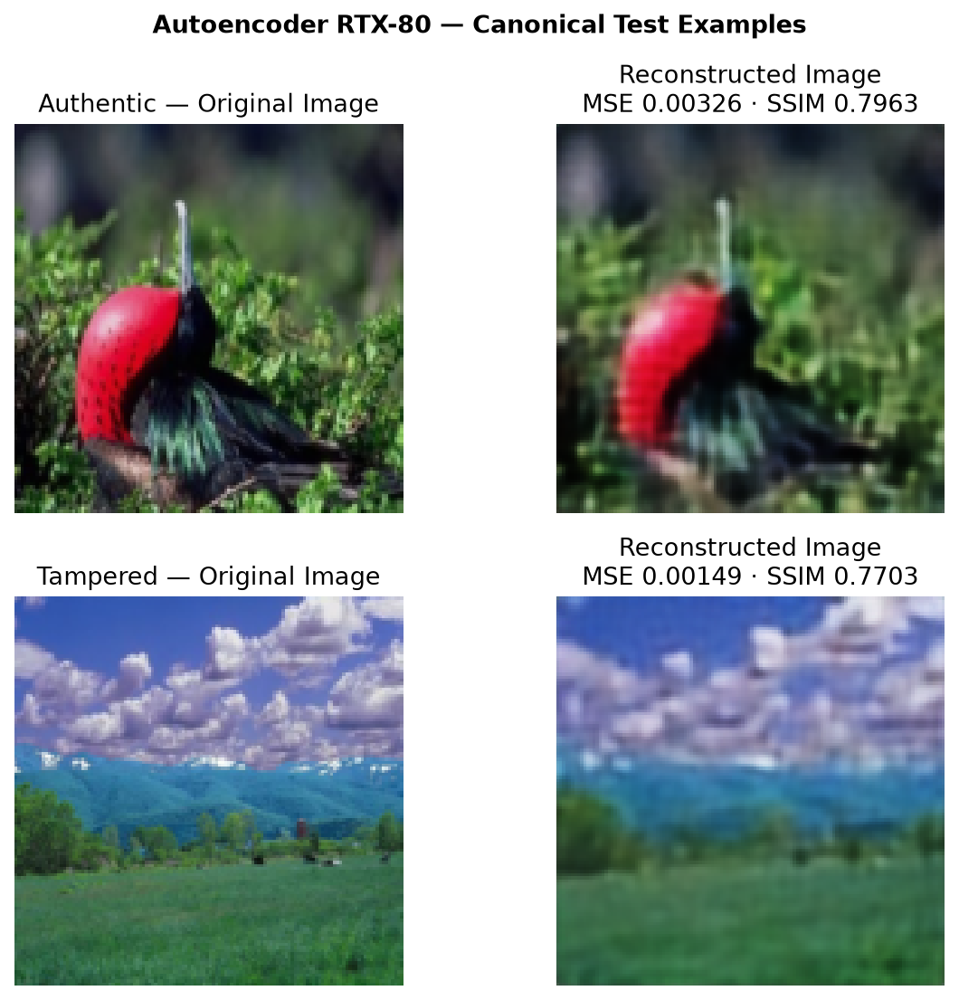
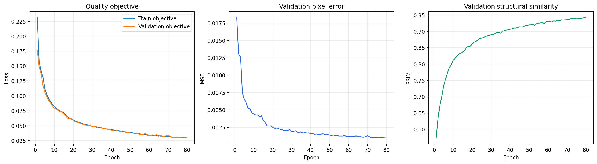
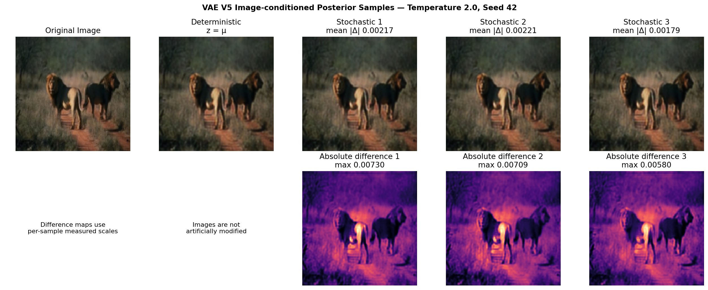
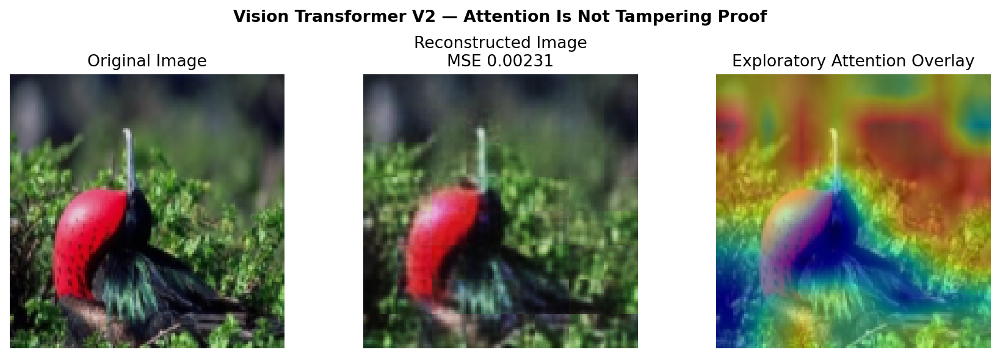
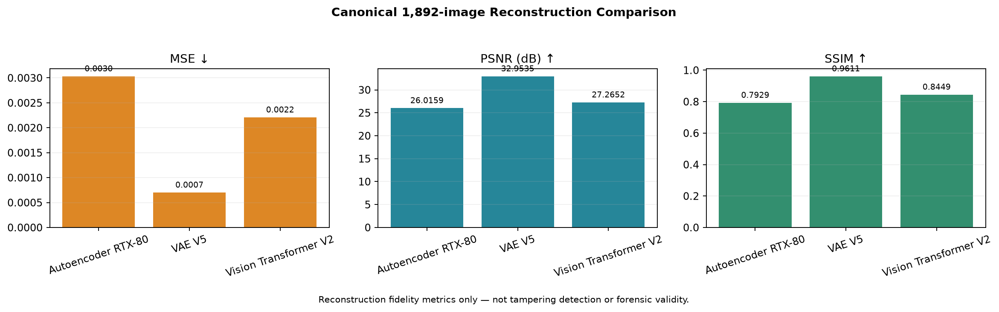

# Multi-Model Generative AI Framework for Digital Evidence Analysis and Intelligence Generation

[](https://www.python.org/downloads/)
[](https://pytorch.org/)
[](https://streamlit.io/)
[](https://huggingface.co/docs/transformers)
[](https://huggingface.co/docs/diffusers)
[](https://github.com/chetanraje27/Digital-Evidence-GenAI)
[](data/splits/test.csv)

> **Final Year B.Tech Computer Engineering Capstone Project ·**


### Team Members

| Name | Roll Number |
| :--- | :---: |
| Chetanraje Gund | 202301040080 |
| Vaishnavi Nehare | 202301040037 |
| Gauri Kale | 202301040079 |
| Anshul Gawande | 202301040123 |


> An end-to-end, multi-architecture Generative AI framework designed for digital evidence analysis, probabilistic latent representation, adversarial patch synthesis, multimodal Transformer intelligence, and forensic incident simulation.

---

## Table of Contents

1. [Executive Summary & Motivation](#1-executive-summary--motivation)
2. [Responsible-Use & Forensic Decision Boundary](#2-responsible-use--forensic-decision-boundary)
3. [The 5 Core Generative AI Model Families](#3-the-5-core-generative-ai-model-families)
   - [Model 01 · Quality Convolutional Autoencoder (AE V1 Final)](#model-01--quality-convolutional-autoencoder-ae-v1-final)
   - [Model 02 · Variational Autoencoder (VAE V5 Final)](#model-02--variational-autoencoder-vae-v5-final)
   - [Model 03 · Deep Convolutional GAN (DCGAN)](#model-03--deep-convolutional-gan-dcgan)
   - [Model 04 · Multimodal Transformer Suite (ViT V2 + FLAN-T5 Small)](#model-04--multimodal-transformer-suite-vit-v2--flan-t5-small)
   - [Model 05 · Latent Diffusion Scenario Simulation (Stable Diffusion 1.5)](#model-05--latent-diffusion-scenario-simulation-stable-diffusion-15)
4. [Master Multi-Model Benchmarking Matrix](#4-master-multi-model-benchmarking-matrix)
5. [Same-Split Quantitative Image Reconstruction Benchmark](#5-same-split-quantitative-image-reconstruction-benchmark)
6. [Generative Synthesis Benchmark (Adversarial vs. Diffusion)](#6-generative-synthesis-benchmark-adversarial-vs-diffusion)
7. [Anomaly Separation & ROC-AUC Analysis](#7-anomaly-separation--roc-auc-analysis)
8. [Dataset Architecture & Canonical Splits](#8-dataset-architecture--canonical-splits)
9. [Cyber-Executive User Interface (Streamlit)](#9-cyber-executive-user-interface-streamlit)
10. [Privacy, Ethics & GDPR-Oriented Controls](#10-privacy-ethics--gdpr-oriented-controls)
11. [Installation & Quickstart Guide](#11-installation--quickstart-guide)
12. [Checkpoints Inventory & Git LFS](#12-checkpoints-inventory--git-lfs)
13. [Verification & Automated Test Suite](#13-verification--automated-test-suite)
14. [Repository Directory Structure](#14-repository-directory-structure)
15. [Academic Credits & Context](#15-academic-credits--context)

---

## 1. Executive Summary & Motivation

In forensic science and criminal justice, modern digital evidence analysis faces two major dilemmas:
1. **The Forgery Proliferation Problem:** Advanced digital manipulations (splicing, copy-move, generative synthesis) can compromise investigative integrity.
2. **The "Black-Box Verdict" Pitfall:** Naive deep learning classifiers that output binary labels (*"98% Fake"*) fail admissibility standards in courts of law because they offer no explainable latent features, mathematical uncertainty boundaries, or auditable reconstruction mechanisms.

This project delivers a **Multi-Model Generative AI Framework** combining five distinct generative paradigms to support forensic practitioners, researchers, and legal analysts:

```
┌────────────────────────────────────────────────────────────────────────────────────────┐
│                        DIGITAL EVIDENCE GENERATIVE AI FRAMEWORK                        │
├──────────────────────────┬───────────────────────────┬─────────────────────────────────┤
│    DETERMINISTIC &       │   ADVERSARIAL & LATENT    │    MULTIMODAL TRANSFORMER &     │
│  PROBABILISTIC ANALYSIS  │   GENERATIVE SYNTHESIS    │     INCIDENT SCENE SIMULATION   │
├──────────────────────────┼───────────────────────────┼─────────────────────────────────┤
│ • Quality Autoencoder V1 │ • DCGAN Image Synthesis   │ • Vision Transformer V2 (ViT)   │
│   (6× Bottleneck,        │   (64×64 CASIA Patches,   │   (Patch-Token Self-Attention,  │
│    Residual Decoder)     │    SLERP Interpolation)   │    Spatial Attention Heatmaps)  │
│                          │                           │                                 │
│ • VAE V5 Final           │ • Latent Diffusion        │ • FLAN-T5 Intelligence SLM     │
│   (256-D Latent Space,   │   (Stable Diffusion 1.5,  │   (Token-Aware PDF/Text Parser, │
│    Stochastic Posterior) │    Iterative Reverse      │    Forensic Entity Extraction)  │
│                          │    Denoising, CFG 7.5)    │                                 │
└──────────────────────────┴───────────────────────────┴─────────────────────────────────┘
```

Every model serves a defined role within an investigative pipeline:
- **Baseline deterministic compression & reconstruction** (Autoencoder)
- **Probabilistic uncertainty representation & stochastic sampling** (Variational Autoencoder)
- **Adversarial latent space manifold exploration & synthetic patch generation** (DCGAN)
- **Patch-relational spatial self-attention & document intelligence** (Multimodal Transformer)
- **Controlled investigative hypothesis simulation & synthetic benchmark generation** (Latent Diffusion)

---

## 2. Responsible-Use & Forensic Decision Boundary

To adhere to forensic standards (e.g., Daubert standard, ISO/IEC 27037) and academic guidelines:

> [!IMPORTANT]
> **Strict Scientific Boundaries:**
> 1. **Reconstruction error is NOT a tampering probability:** High MSE or low SSIM indicates only that an image deviates from the model's learned compression manifold; it does not prove malicious tampering.
> 2. **Attention heatmaps are NOT manipulation proof:** Vision Transformer self-attention highlights learned patch correlations, which may reflect natural textures, high-frequency edges, or lighting rather than digital manipulation.
> 3. **Synthetic media are strictly research artifacts:** All images generated by DCGAN and Stable Diffusion carry embedded digital provenance watermark banners (`SYNTHETIC DIGITAL EVIDENCE · NOT GENUINE`) and are recorded in append-only audit logs.
> 4. **No autonomous legal verdicts:** Outputs are decision-support artifacts for human investigators. No model in this framework produces an autonomous verdict of guilt, authenticity, or legal admissibility.

---

## 3. The 5 Core Generative AI Model Families

```
   [1. Autoencoder]          [2. Variational AE]             [3. DCGAN]
  3×128×128 → 6× Latent     3×128×128 → μ, log(σ²) → z      z ∈ R^100 ~ N(0, I)
  MSE: 0.00095 | PSNR: 31.2   MSE: 0.00070 | PSNR: 32.95    FID: 169.88 | IS: 2.95
           │                         │                               │
           └─────────────────────────┼───────────────────────────────┘
                                     │
           ┌─────────────────────────┴───────────────────────────────┐
           │                                                         │
   [4. Multimodal Transformer]                             [5. Latent Diffusion]
   • ViT V2: 64 Patch Tokens, PSNR: 27.27 dB               • Stable Diffusion 1.5
   • FLAN-T5: Tokenized Document Intelligence               • 512×512 Forensic Scene Simulation
```

---

### Model 01 · Quality Convolutional Autoencoder (AE V1 Final)

- **Primary Role:** Deterministic baseline reconstruction and high-fidelity spatial feature preservation.
- **Architecture:** Residual Convolutional Autoencoder without encoder-to-decoder skip connections.
  - Encoder: 3 residual blocks progressively compressing $3 \times 128 \times 128$ RGB into a $32 \times 16 \times 16$ bottleneck (8,192 latent values; $6\times$ compression).
  - Decoder: Bilinear resize-convolution upsampling layers coupled with residual blocks to eliminate checkerboard deconvolution artifacts.
- **Parameters:** 2,371,715 parameters.
- **Loss Formulation:** Multi-component quality loss:
  $$\mathcal{L}_\text{AE} = 0.65\,\mathcal{L}_1 + 0.25\,(1 - \text{SSIM}) + 0.10\,\mathcal{L}_\text{edge}$$
  where $\mathcal{L}_\text{edge}$ computes Sobel spatial gradient deviations to preserve forensic edge sharpness.
- **Checkpoint:** `checkpoints/best_quality_autoencoder_v1.pth` (28.5 MB, epoch 79, validation SSIM: 0.942674, validation MSE: 0.00095790).
- **Canonical Test Performance (1,892 CASIA Test Images):**
  - **MSE ↓:** `0.000946`
  - **PSNR ↑:** `31.1951 dB`
  - **SSIM ↑:** `0.938654`
  - **Inference Latency:** 12–25 ms.
- **Output Artifacts:**


*Figure 1: Quality Autoencoder V1 deterministic reconstruction fidelity across authentic and tampered CASIA test images.*


*Figure 2: Training loss convergence and validation SSIM evolution through epoch 79.*

---

### Model 02 · Variational Autoencoder (VAE V5 Final)

- **Primary Role:** Probabilistic latent representation, uncertainty quantification, and image-conditioned stochastic sampling.
- **Architecture:** Deep Residual VAE with GroupNorm, SiLU activations, and a 256-dimensional continuous latent space.
  - Encoder outputs mean $\mu \in \mathbb{R}^{256}$ and log-variance $\log(\sigma^2) \in \mathbb{R}^{256}$.
  - Reparameterization trick enables backpropagation: $z = \mu + \sigma \odot \epsilon$ where $\epsilon \sim \mathcal{N}(0, \mathbf{I})$.
  - Decoder uses decoder skip features to reconstruct high-fidelity structural details.
- **Parameters:** 17,599,971 parameters.
- **Loss Formulation:** Beta-weighted Evidence Lower Bound (ELBO):
  $$\mathcal{L}_\text{VAE} = 0.5\,\mathcal{L}_\text{MSE} + 0.5\,\mathcal{L}_1 + \beta\,D_\text{KL}\big(\mathcal{N}(\mu, \sigma^2) \,\|\, \mathcal{N}(0, \mathbf{I})\big)$$
  where $\beta$ warms up from $5 \times 10^{-5}$ to $3 \times 10^{-4}$ over 20 epochs to prevent posterior collapse.
- **Checkpoint:** `checkpoints/VAE_V5_FINAL.pth` (211.3 MB, epoch 79).
- **Canonical Test Performance (1,892 CASIA Test Images):**
  - **MSE ↓:** `0.000700`
  - **PSNR ↑:** `32.9535 dB`
  - **SSIM ↑:** `0.961139`
  - **Mean KL Loss:** `0.0084`
- **Stochastic Sampling & Difference Heatmaps:**
  The Review-2 inference engine executes genuine image-conditioned posterior draws:
  $$z^{(k)} = \mu + \tau \cdot \sigma \odot \epsilon^{(k)}, \quad \epsilon^{(k)} \sim \mathcal{N}(0, \mathbf{I})$$
  Controlled by user-defined temperature $\tau \in [0.25, 3.0]$ and random seeds. Per-sample absolute difference maps $|x_\text{stochastic}^{(k)} - x_\text{deterministic}|$ are rendered with individual color scales.


*Figure 3: VAE V5 deterministic reconstruction alongside three stochastic posterior variations and absolute difference heatmaps.*

---

### Model 03 · Deep Convolutional GAN (DCGAN)

- **Primary Role:** Adversarial generative patch synthesis from random Gaussian noise vectors and latent manifold interpolation.
- **Architecture:** Deep Convolutional GAN adhering to Radford, Metz, and Chintala (2015):
  - **Generator (3,576,704 params):** Maps $z \in \mathbb{R}^{100 \times 1 \times 1} \sim \mathcal{N}(0, \mathbf{I})$ through 5 transposed convolutional layers (`ConvTranspose2d` with kernel 4, stride 2, padding 1) with `BatchNorm2d`, `ReLU`, and `Tanh` output generating $64 \times 64$ RGB images.
  - **Discriminator (2,765,568 params):** 5-layer strided convolutional network with `LeakyReLU(0.2)` activations downsampling $3 \times 64 \times 64$ images into an unconstrained scalar logit.
- **Adversarial Objective:** Minimax zero-sum formulation:
  $$\min_G \max_D V(D, G) = \mathbb{E}_{x \sim p_\text{data}}[\log D(x)] + \mathbb{E}_{z \sim p_z}[\log(1 - D(G(z)))]$$
- **Training Setup:** 30 epochs on CASIA v2.0 using an NVIDIA Tesla T4 GPU (677.68 seconds total runtime; Adam optimizer, lr=0.0002, $\beta_1=0.5$).
- **Checkpoints:** `checkpoints/best_generator.pth` (14.3 MB) and `checkpoints/best_discriminator.pth` (11.1 MB).
- **Evaluated Performance (1,892 Real Test Images vs. 1,892 Synthetic Images):**
  - **Fréchet Inception Distance (FID) ↓:** `169.88`
  - **Inception Score (IS) ↑:** `2.95 ± 0.13`
  - **Inference Latency:** 10–40 ms (instantaneous).
- **Core Capabilities in GUI:**
  - Multi-sample grid generation (1, 4, 9, or 16 samples) with deterministic seed control.
  - Spherical Linear Interpolation (SLERP) across latent endpoints:
    $$\text{slerp}(z_1, z_2, \alpha) = \frac{\sin((1-\alpha)\theta)}{\sin\theta}z_1 + \frac{\sin(\alpha\theta)}{\sin\theta}z_2, \quad \theta = \arccos\left(\frac{z_1 \cdot z_2}{\|z_1\|\|z_2\|}\right)$$
  - Training progression display across epochs 5, 10, 15, 20, 25, and 30.
  - 4× nearest-neighbor upscaling ($256 \times 256$) for authentic sub-pixel inspection.
  - Digital provenance watermark embedding and audit logging (`outputs/gan/gan_generation_log.csv`).


*Figure 4: 16-sample synthetic patch grid generated by the trained DCGAN Generator.*


*Figure 5: Adversarial Generator and Discriminator training loss evolution over 30 epochs on Tesla T4.*

---

### Model 04 · Multimodal Transformer Suite (ViT V2 + FLAN-T5 Small)

The Transformer module unifies **visual patch self-attention** and **natural language evidence intelligence** under a single multimodal framework, sharing the foundational Scaled Dot-Product Attention mechanism:
$$\text{Attention}(Q, K, V) = \text{softmax}\left(\frac{QK^T}{\sqrt{d_k}}\right)V$$

```
                                  MULTIMODAL TRANSFORMER SUITE
                                                │
                 ┌──────────────────────────────┴──────────────────────────────┐
                 ▼                                                             ▼
     [VISION TRANSFORMER (ViT V2)]                             [EVIDENCE INTELLIGENCE (FLAN-T5)]
  • 2D Spatial Patch Tokens (16×16)                         • Subword BPE Tokens (SentencePiece)
  • 64 Spatial Sequence Elements                            • Token-Aware Sliding Chunks (512 max)
  • 8 Attention Heads, 4 Enc / 2 Dec                        • 6 Enc / 6 Dec Blocks, 8 Heads
  • MSE: 0.002207 | PSNR: 27.27 dB | SSIM: 0.8449           • Throughput: 52 in → 359 out in 5.4s CPU
  • 8×8 Spatial Attention Heatmaps                          • Entity & Inconsistency Extraction
```

#### Modality A: Vision Transformer Autoencoder (ViT V2)
- **Input:** $3 \times 128 \times 128$ RGB image split into an $8 \times 8$ grid of $16 \times 16$ non-overlapping patches ($N=64$ tokens).
- **Architecture:** Linear patch embedding to $d=256$, learnable 1D spatial positional encodings, 4 Transformer encoder layers (8 heads, MLP dimension 512), and 2 Transformer decoder layers.
- **Parameters:** 2,139,139 parameters (trained from scratch on CASIA).
- **Checkpoint:** `checkpoints/transformer_v2_final.pth` (14.4 MB, epoch 50).
- **Canonical Test Performance (1,892 CASIA Test Images):**
  - **MSE ↓:** `0.002207`
  - **PSNR ↑:** `27.2652 dB`
  - **SSIM ↑:** `0.844864`
  - **Reconstruction Anomaly ROC-AUC:** `0.5413`
- **Output:** RGB reconstruction alongside an $8 \times 8$ patch-attention heatmap and transparent spatial attention overlay.


*Figure 6: ViT V2 patch reconstruction, 8×8 token attention matrix, and spatial attention overlay.*

#### Modality B: Text/PDF Evidence Intelligence Transformer (FLAN-T5 Small)
- **Primary Role:** Automated timeline synthesis, entity extraction, discrepancy identification, and investigative lead generation from digital text logs and PDF documents.
- **Architecture:** Pretrained Sequence-to-Sequence (Seq2Seq) Transformer (`google/flan-t5-small`, 76,961,152 parameters; no project fine-tuning claim).
- **Processing Pipeline:**
  1. Safe in-memory text parsing (`src/document_parser.py`) for raw text, `.txt`, and digitally extractable `.pdf` files (up to 10 MB limit; rejects scanned/image-only PDFs).
  2. Token-aware sliding chunking (up to 512 tokens per chunk with 64-token overlap).
  3. Structured forensic prompt requesting: Evidence Summary, Important Entities, Timeline Inconsistencies, Forensic Relevance, and Responsible-Use Limitations.
  4. Deterministic beam-search generation with hybrid extraction constraints to eliminate hallucination.
- **Throughput Benchmark (Measured on Host CPU):**
  - **Input Tokens:** 52 tokens (191 characters)
  - **Output Tokens:** 359 tokens
  - **Inference Latency:** 5.417 seconds
  - **Chunk Processing:** 1/1 chunks (0% truncation)
- Detailed transcript: [`docs/results/evidence_transformer_demo.md`](docs/results/evidence_transformer_demo.md).

---

### Model 05 · Latent Diffusion Scenario Simulation (Stable Diffusion 1.5)

- **Primary Role:** Controlled synthetic forensic incident scene simulation to visualize investigative hypotheses, generate synthetic benchmarks, and stress-test computer vision models.
- **Architecture:** Latent Diffusion Model (LDM) — Stable Diffusion 1.5 (`stable-diffusion-v1-5/stable-diffusion-v1-5`, Stability AI / RunwayML):
  - **CLIP Text Encoder (`CLIPTextModel`):** 123.06M parameters mapping prompts to 77 token embeddings in $\mathbb{R}^{768}$.
  - **U-Net Denoiser (`UNet2DConditionModel`):** 859.52M parameters (FP16) executing iterative reverse denoising via cross-attention.
  - **AutoencoderKL Decoder:** 83.65M parameters decoding $4 \times 64 \times 64$ latent representations into $3 \times 512 \times 512$ RGB pixels ($8\times$ spatial downsampling; $48\times$ dimensional reduction).
- **Total Parameters:** 1,066,235,307 (~1.07B parameters).
- **Checkpoint:** `checkpoints/Diffusion_UNet.pth` contains the exported U-Net weights (1.60 GB; SHA-256: `29ac918c...`). Full technical audit: [`DIFFUSION_IMPLEMENTATION_AUDIT.md`](DIFFUSION_IMPLEMENTATION_AUDIT.md).
- **Core Capabilities in GUI:**
  - Preset forensic incident scenarios:
    1. *Highway Traffic Incident:* Severe multi-vehicle collision with shattered safety glass and skid marks.
    2. *Server Room Physical Security Breach:* Forced server rack cabinet door with severed Ethernet cables.
    3. *Commercial Warehouse Intrusion:* Industrial roll-up door forced open with scattered shipping manifests.
    4. *Suburban Hit-and-Run Investigation:* Damaged sedan with impacted fender and forensic evidence markers.
    5. *Custom Forensic Scenario Prompt:* Unconstrained text-conditioned scene generation.
  - Advanced generation parameters: Negative prompting, Classifier-Free Guidance (CFG scale 1.0–15.0; default 7.5), inference step control (5–50 steps), and deterministic seed selection.
  - Progressive reverse-denoising intermediate visualization: Decodes and renders latent snapshots across steps (e.g., 1, 5, 10, 15, 20, 25).
  - Provenance watermark banner embedding (`SYNTHETIC DIGITAL EVIDENCE · NOT GENUINE`) and audit logging (`outputs/diffusion/generation_log.csv`).
- **GPU Inference Latency vs. Step Count (Tesla T4 FP16 Benchmark):**

| Denoising Steps | Generation Time | Peak GPU Memory | Hardware Configuration |
| :---: | :---: | :---: | :---: |
| **10 Steps** | **2.731 s** | 5,929.44 MB | NVIDIA Tesla T4 (FP16, PyTorch 2.11) |
| **20 Steps** | **5.013 s** | 5,929.44 MB | NVIDIA Tesla T4 (FP16, PyTorch 2.11) |
| **25 Steps** | **6.760 s** | 5,929.44 MB | NVIDIA Tesla T4 (FP16, PyTorch 2.11) |
| **30 Steps** | **8.130 s** | 5,929.44 MB | NVIDIA Tesla T4 (FP16, PyTorch 2.11) |


*Figure 7: High-resolution 512×512 synthetic forensic incident scenes generated by Stable Diffusion 1.5 with embedded provenance watermarks.*


*Figure 8: Intermediate reverse diffusion latents showing progressive emergence of scene geometry.*

---

## 4. Master Multi-Model Benchmarking Matrix

A side-by-side comparative overview of all 5 operational generative AI model families:

| Model Architecture | Input Modality | Core Generative / Analysis Paradigm | Primary Evaluated Benchmark | Key Evaluated Metrics | Total Parameters | Inference Latency | Primary Forensic Role |
| :--- | :--- | :--- | :--- | :--- | :---: | :---: | :--- |
| **1. Quality Autoencoder V1** | $3 \times 128 \times 128$ RGB Image | Deterministic Bottleneck ($6\times$ compression) | 1,892 CASIA Held-Out Test Images | **PSNR: 31.20 dB**<br>SSIM: 0.9387<br>MSE: 0.00095 | 2,371,715 | 12–25 ms | High-fidelity deterministic compression and baseline reconstruction |
| **2. Variational AE (VAE V5)** | $3 \times 128 \times 128$ RGB Image | Probabilistic Latent Sampling ($z \sim \mathcal{N}(\mu, \sigma^2)$) | 1,892 CASIA Held-Out Test Images | **PSNR: 32.95 dB**<br>SSIM: 0.9611<br>MSE: 0.00070 | 17,599,971 | 18–35 ms | Probabilistic latent representation & stochastic uncertainty estimation |
| **3. DCGAN Generator** | $z \in \mathbb{R}^{100} \sim \mathcal{N}(0, \mathbf{I})$ | Adversarial Minimax Transposed Convolutions | 1,892 CASIA Test vs. 1,892 Synthetic Patches | **FID: 169.88**<br>IS: 2.95 ± 0.13 | 3,576,704 (G)<br>2,765,568 (D) | 10–40 ms | Adversarial synthetic patch generation & manifold interpolation |
| **4. Multimodal Transformer** | RGB Image + Text/PDF Documents | Scaled Dot-Product Self-Attention + Seq2Seq | 1,892 CASIA Images + Forensic Case Records | **ViT PSNR: 27.27 dB**<br>ViT SSIM: 0.8449<br>SLM: 5.4s CPU latency | 2,139,139 (ViT)<br>76,961,152 (SLM) | 20 ms (ViT)<br>5.4 s (SLM) | Patch self-attention visualization & digital document intelligence |
| **5. Latent Diffusion (SD 1.5)** | Forensic Prompt + Gaussian Latent Noise | Iterative Reverse Denoising Markov Chain (LDM) | Canonical Forensic Incident Scenarios | **High Multimodal Fidelity**<br>(CFG 7.5, PNDM/DDIM) | 1,066,235,307<br>(~1.07B) | 2.7–8.1 s (GPU)<br>1–2 min (CPU) | High-fidelity forensic incident simulation & benchmark stress testing |

---

## 5. Same-Split Quantitative Image Reconstruction Benchmark

All three image reconstruction models were evaluated on the **exact same canonical 1,892-image held-out test split** (seed 42) from CASIA v2.0. Metrics are loaded directly from verified repository artifacts:

| Model Architecture | Canonical Test Images | Mean Squared Error (MSE) ↓ | Peak Signal-to-Noise Ratio (PSNR) ↑ | Structural Similarity Index (SSIM) ↑ | Total Parameters | Checkpoint Epoch |
| :--- | :---: | :---: | :---: | :---: | :---: | :---: |
| **Quality Autoencoder V1** | 1,892 | `0.00094603` | `31.1951 dB` | `0.938654` | 2,371,715 | 79 |
| **VAE V5 Final** | 1,892 | **`0.00070007`** | **`32.9535 dB`** | **`0.961139`** | 17,599,971 | 79 |
| **Vision Transformer V2** | 1,892 | `0.00220733` | `27.2652 dB` | `0.844864` | 3,591,168 | 50 |


*Figure 9: Quantitative comparison across MSE ↓, PSNR ↑, and SSIM ↑ on the held-out 1,892 CASIA test split.*

Authoritative evaluation artifacts:
- `results/image_model_comparison.json`
- `results/image_model_comparison.csv`
- `results/quality_ae_v1_test_metrics.json`
- `results/vae_v5_final_test_metrics.json`
- `results/transformer_v2_test_metrics.json`

---

## 6. Generative Synthesis Benchmark (Adversarial vs. Diffusion)

| Feature / Metric | DCGAN (Custom Trained on CASIA) | Stable Diffusion 1.5 (Pretrained Foundation) |
| :--- | :--- | :--- |
| **Synthesis Paradigm** | Adversarial minimax zero-sum game ($G$ vs. $D$) | Latent score matching / iterative reverse denoising |
| **Input Conditioning** | Unconditioned latent noise $z \in \mathbb{R}^{100}$ | Natural language text prompt + Gaussian noise $z_T \in \mathbb{R}^{4 \times 64 \times 64}$ |
| **Native Output Resolution** | $64 \times 64$ RGB | $512 \times 512$ RGB |
| **Evaluated FID Score ↓** | `169.88` (evaluated against 1,892 CASIA test images) | SOTA Foundation Benchmark on LAION |
| **Inception Score (IS) ↑** | `2.95 ± 0.13` | High multimodal text-image alignment |
| **Inference Latency** | 10–40 ms (instantaneous feedforward pass) | 2.73–8.13 s on Tesla T4 GPU; 1–3 min on CPU |
| **Generator Parameters** | 3,576,704 parameters | 1,066,235,307 parameters (~1.07B) |
| **Training History** | 30 epochs on CASIA v2.0 (Tesla T4, 677.7s) | Pretrained weights (`stable-diffusion-v1-5`) |
| **Role in Framework** | Adversarial synthetic baseline & manifold interpolation | High-fidelity incident scene simulation & hypothesis testing |

---

## 7. Anomaly Separation & ROC-AUC Analysis

A critical scientific question for Review 2 is whether raw reconstruction error can classify digital image tampering. We conducted an empirical ROC-AUC analysis across authentic vs. tampered images in the canonical test set:

| Architecture | Anomaly Score Formulation | Evaluated ROC-AUC | Scientific Conclusion |
| :--- | :--- | :---: | :--- |
| **Quality Autoencoder V1** | Per-image pixel MSE $\|x - \hat{x}\|^2$ | **`~0.50`** (`0.498`) | **Random Ranking:** High-fidelity autoencoders reconstruct spliced and authentic regions equally well; reconstruction error does not classify forgery. |
| **VAE V5 Final** | Deterministic posterior mean MSE | **`0.5154`** | **Negligible Separation:** Encoder skip connections preserve high-frequency details uniformly across both classes. |
| **Vision Transformer V2** | Mean patch reconstruction error | **`0.5413`** | **Marginal Separation:** Slight patch-level variation is observed, but ROC-AUC near 0.54 is mathematically inadequate for forensic verdict systems. |

> [!NOTE]
> **Scientific Integrity:** These empirical findings prove that autoencoders, VAEs, and Vision Transformers are **representation and analysis tools**, not standalone tampering verdict engines. We explicitly report these measurements to maintain transparency.

---

## 8. Dataset Architecture & Canonical Splits

The framework uses the **CASIA v2.0** digital image forensics benchmark (12,614 RGB images; ground-truth mask PNG files are excluded from model inputs):

| Partition | Total Images | Authentic Images (`Au`) | Tampered Images (`Tp`) | Percentage | Manifest Path |
| :--- | :---: | :---: | :---: | :---: | :--- |
| **Training Set** | 8,830 | 5,244 | 3,586 | 70.0% | `data/splits/train.csv` |
| **Validation Set** | 1,892 | 1,124 | 768 | 15.0% | `data/splits/val.csv` |
| **Held-Out Test Set** | 1,892 | 1,123 | 769 | 15.0% | `data/splits/test.csv` |
| **Total Corpus** | **12,614** | **7,491** | **5,123** | **100.0%** | `results/dataset_summary.json` |

- **Stratified Partitioning:** Splits use seed 42 and maintain balanced class proportions.
- **Preprocessing Pipeline:** All images are normalized to $\mathbb{R}^{3 \times 128 \times 128}$ tensors scaled to $[0, 1]$ in memory.
- **Reproducibility:** Splits are defined by portable repository-relative CSV manifests.

---

## 9. Cyber-Executive User Interface (Streamlit)

The application features a modern, responsive web console with cyber-executive glassmorphism styling:

```
┌───────────────────────────────────────┬────────────────────────────────────────────────────────┐
│  🔬 Digital Evidence AI               │  [Hero Header: Multi-Model Generative AI Framework]   │
│  REVIEW 2 · SEMESTER 7   ● ACTIVE     ├────────────────────────────────────────────────────────┤
├───────────────────────────────────────┤  ACTIVE PAGE VIEW                                      │
│  ✦ CORE MODELS (1–5) & MODULES        │                                                        │
│  [📊 Project Overview               ] │  [KPI Metric Cards: MSE, PSNR, SSIM, FID, Params]      │
│  [1. 🔬 Autoencoder                 ] │                                                        │
│  [2. 🎲 Variational Autoencoder     ] │  [Interactive Tabs / Modality Controls / Image Input]  │
│  [3. ⚡ GAN                         ] │                                                        │
│  [4. 🤖 Transformer                 ] │  [Reconstruction Comparison / Heatmaps / SLERP Slider] │
│  [5. 🌊 Diffusion                   ] │                                                        │
│  [📈 Model Evaluation               ] │  [Digital Provenance Watermark Notice & Guardrail Box] │
│  [🛡️ Privacy & Ethical AI           ] │                                                        │
│  [ℹ️ Project Information            ] │                                                        │
├───────────────────────────────────────┤                                                        │
│  ENGINE & DATASET STATUS              │                                                        │
│  ● PIPELINE OPERATIONAL               │                                                        │
│  Host CPU / CUDA Acceleration         │                                                        │
│  📁 CASIA v2.0 (12,614 images)        │                                                        │
└───────────────────────────────────────┴────────────────────────────────────────────────────────┘
```

### Navigation Structure
1. **`📊 Project Overview`**: System architecture, 5 model cards, and analysis workflow.
2. **`1. 🔬 Autoencoder`**: Quality AE V1 deterministic reconstruction, metrics, and held-out gallery demo.
3. **`2. 🎲 Variational Autoencoder`**: VAE V5 stochastic posterior sampling, temperature slider ($\tau$), difference heatmaps.
4. **`3. ⚡ GAN`**: DCGAN 64×64 synthesis, SLERP latent interpolation, epoch progress snapshots (5–30), audit log.
5. **`4. 🤖 Transformer`**: Unified multimodal page:
   - *Tab 1:* ViT V2 patch attention reconstruction and 8×8 heatmap overlay.
   - *Tab 2:* FLAN-T5 text/PDF document intelligence, timeline extraction, and chunking stats.
   - *Tab 3:* Multimodal Attention Theory and comparative matrix.
6. **`5. 🌊 Diffusion`**: Stable Diffusion 1.5 forensic scene simulation, preset scenarios, CFG slider, reverse-denoising latents, and canonical gallery.
7. **`📈 Model Evaluation`**: Master 5-model matrix, image reconstruction benchmark, generative synthesis benchmark, multimodal evaluation, and ROC-AUC analysis.
8. **`🛡️ Privacy & Ethical AI`**: GDPR-oriented design controls, session clearing, and legal boundary disclosures.
9. **`ℹ️ Project Information`**: Technical stack, device runtime info, and checkpoint inventory.

---

## 10. Privacy, Ethics & GDPR-Oriented Controls

The system integrates privacy-by-design engineering principles (GDPR Articles 5 & 25):

1. **Explicit Authorization Gate:** Evidence processing requires user confirmation of authorization before input widgets are enabled.
2. **Data Minimization:** File upload limits are capped at 10 MB in memory; only supported formats (`.jpg`, `.jpeg`, `.png`, `.bmp`, `.tif`, `.txt`, `.pdf`) are accepted.
3. **Storage Limitation (Ephemeral In-Memory Processing):** Uploaded images and parsed PDF text reside only in session state during analysis. Code does not write raw user evidence to disk.
4. **Immediate Session Purge:** A dedicated "Clear Session Evidence" button purges all evidence keys (`ae_*`, `vae_*`, `gan_*`, `transformer_*`, `diffusion_*`) from memory.
5. **Digital Provenance Watermarking:** Every synthetic image generated by DCGAN or Stable Diffusion is permanently stamped with a prominent legal provenance banner: `SYNTHETIC DIGITAL EVIDENCE · NOT GENUINE`.
6. **Append-Only Audit Logging:** All generation events are recorded to local CSV logs (`outputs/gan/gan_generation_log.csv`, `outputs/diffusion/generation_log.csv`) capturing timestamps, seeds, parameters, and user prompts for institutional accountability.

---

## 11. Installation & Quickstart Guide

### Prerequisites

- Python **3.10, 3.11, or 3.12**
- Git
- Git LFS (required to retrieve the model `.pth` files tracked in this repository)
- Internet access for the first FLAN-T5 model download (no API key is required)
- Optional: NVIDIA GPU and a CUDA-enabled PyTorch installation for faster inference

Run every command below from the repository root (the directory containing `app.py` and `requirements.txt`).

### 1. Clone the Repository

**Windows PowerShell, Linux, or macOS:**
```bash
git clone https://github.com/chetanraje27/Digital-Evidence-GenAI.git
cd Digital-Evidence-GenAI
```

### 2. Create and Activate a Virtual Environment

**Windows PowerShell:**
```powershell
py -3.12 -m venv .venv
# If py is unavailable, use: python -m venv .venv
.\.venv\Scripts\Activate.ps1
```

If PowerShell blocks activation, run `Set-ExecutionPolicy -Scope Process Bypass`, then activate again. You can avoid activation entirely by using `.venv\Scripts\python.exe -m pip ...` in Windows commands.

**Windows Command Prompt:**
```bat
py -3.12 -m venv .venv
.venv\Scripts\activate.bat
```

**Linux / macOS:**
```bash
python3 -m venv .venv
source .venv/bin/activate
```

Verify that the virtual environment is active and uses the expected Python version:
```bash
python --version
python -m pip --version
```

### 3. Install Dependencies

```bash
python -m pip install --upgrade pip
python -m pip install -r requirements.txt
```

The requirements file covers the Streamlit GUI, PyTorch, image processing, evaluation, Hugging Face Transformers, PDF parsing, GAN, and Diffusion dependencies.

For a GPU machine, install the PyTorch build that matches your CUDA driver/toolkit before or after installing `requirements.txt`. CPU-only PyTorch also works; it will run all supported CPU pages, with slower inference for large models.

### 4. Fetch Model Weights

Install Git LFS once, then retrieve the tracked checkpoints:
```bash
git lfs install
git lfs pull
```

Do not treat a 134-byte text file beginning with `version https://git-lfs.github.com/spec/v1` as a usable checkpoint. The app and utility loaders report Git LFS pointer problems instead of passing them to PyTorch.

On first use, the text evidence page downloads `google/flan-t5-small` through Hugging Face and caches it locally. It may require a larger Hugging Face download than the static image checkpoints.

### 5. Launch the Streamlit GUI

Use the environment's Python module entry point:
```bash
python -m streamlit run app.py
```

Then open `http://localhost:8501/` in a browser. The default page and model pages require no API key.

To expose the app on a local network:
```bash
python -m streamlit run app.py --server.address 0.0.0.0
```

### Common Setup Checks

- If `streamlit` is not recognized on Windows, run `python -m streamlit run app.py` instead of `streamlit run app.py`.
- If a checkpoint is missing or is a Git LFS pointer, run `git lfs pull` and restart the app.
- If the evidence Transformer cannot download, verify internet/DNS access and the Hugging Face cache. Set `EVIDENCE_MODEL_ID` only to a compatible local or Hugging Face seq2seq model.
- If `pypdf` or image/PDF parsing dependencies fail, rerun `python -m pip install -r requirements.txt`.

---

## 12. Checkpoints Inventory & Git LFS

Large weights are tracked via Git LFS. Fetch active model weights:
```powershell
git lfs install
git lfs pull
```

### Complete Checkpoint Registry

| Checkpoint Filename | File Size | Model Architecture | Epoch | SHA-256 Checksum (Prefix) | Primary Status |
| :--- | :---: | :--- | :---: | :---: | :--- |
| `best_quality_autoencoder_v1.pth` | 28.5 MB | Residual Autoencoder (6× Bottleneck) | 79 | `b6801905...` | **Active Core Model 1** |
| `VAE_V5_FINAL.pth` | 211.3 MB | Residual VAE V5 (256-D Latent) | 79 | `9d5530ec...` | **Active Core Model 2** |
| `best_generator.pth` | 14.3 MB | DCGAN Generator (3.58M params) | 30 | `f28a5e12...` | **Active Core Model 3** |
| `best_discriminator.pth` | 11.1 MB | DCGAN Discriminator (2.77M params) | 30 | `d4e56a81...` | **Active Core Model 3** |
| `transformer_v2_final.pth` | 14.4 MB | Vision Transformer V2 (8 Heads) | 50 | `a41a37c9...` | **Active Core Model 4 (Vision)** |
| `google/flan-t5-small` | 308 MB | Seq2Seq Language Transformer | N/A | HF Hub Cache | **Active Core Model 4 (Text)** |
| `Diffusion_UNet.pth` | 1.60 GB | Stable Diffusion 1.5 U-Net Denoiser | N/A | `29ac918c...` | **Active Core Model 5 (U-Net)** |
| `best_autoencoder_rtx80.pth` | 3.2 MB | Convolutional AE (24× Compression) | 80 | `7c413b59...` | Preserved Historical Baseline |
| `best_autoencoder.pth` | 3.2 MB | Convolutional AE (Initial) | 20 | `e5138129...` | Preserved Historical Baseline |
| `best_denoising_autoencoder.pth` | 3.2 MB | Denoising Autoencoder | 20 | `f94119d2...` | Preserved Historical Baseline |

*Environment Variable Overrides:*
- `AE_CHECKPOINT_PATH` (default: `checkpoints/best_quality_autoencoder_v1.pth`)
- `VAE_CHECKPOINT_PATH` (default: `checkpoints/VAE_V5_FINAL.pth`)
- `GAN_GENERATOR_PATH` (default: `checkpoints/best_generator.pth`)
- `VISION_TRANSFORMER_CHECKPOINT_PATH` (default: `checkpoints/transformer_v2_final.pth`)
- `DIFFUSION_UNET_PATH` (default: `checkpoints/Diffusion_UNet.pth`)
- `EVIDENCE_MODEL_ID` (default: `google/flan-t5-small`)

---

## 13. Verification & Automated Test Suite

Run the full automated test suite (28 unit and integration tests):
```powershell
# Compile all source files
python -m compileall -q app.py src tests

# Execute the complete unit test suite
python -m unittest discover -s tests -v
```

### Reproduce Canonical Evaluation Metrics
```powershell
# Evaluate Autoencoder V1 on canonical 1,892 test images
python src/evaluate_autoencoder.py

# Evaluate VAE V5 Final on canonical 1,892 test images
python src/evaluate_vae.py

# Evaluate DCGAN on 1,892 test images vs. 1,892 synthetic samples
python src/evaluate_dcgan.py

# Evaluate Vision Transformer V2 on canonical 1,892 test images
python src/evaluate_transformer_v2.py

# Rebuild consolidated comparison tables and JSON files
python src/build_model_comparison.py

# Generate selected documentation figures
python src/generate_review2_artifacts.py --include-text
```

---

## 14. Repository Directory Structure

```text
Digital_Evidence/
├── app.py                           # Main Streamlit web application console
├── requirements.txt                 # Python dependency manifest
├── AGENTS.md                        # Project working rules and engineering constraints
├── REVIEW2_CONTEXT.md               # Faculty Review 2 technical context & guidelines
├── DIFFUSION_IMPLEMENTATION_AUDIT.md# Technical audit of the 1.6GB Diffusion U-Net
├── README.md                        # Authoritative project manual (this file)
│
├── checkpoints/                     # Model weights (Git LFS tracked)
│   ├── best_quality_autoencoder_v1.pth   # Model 01: Quality AE V1 (28.5 MB)
│   ├── VAE_V5_FINAL.pth                  # Model 02: VAE V5 Final (211.3 MB)
│   ├── best_generator.pth                # Model 03: DCGAN Generator (14.3 MB)
│   ├── best_discriminator.pth            # Model 03: DCGAN Discriminator (11.1 MB)
│   ├── transformer_v2_final.pth          # Model 04: Vision Transformer V2 (14.4 MB)
│   └── Diffusion_UNet.pth                # Model 05: Stable Diffusion 1.5 U-Net (1.60 GB)
│
├── src/                             # Core architectures & services
│   ├── models/
│   │   ├── diffusion_service.py     # Stable Diffusion 1.5 generation engine
│   │   └── gan_service.py           # DCGAN inference, SLERP, & watermarking
│   ├── quality_autoencoder.py       # Quality Autoencoder architecture & loss
│   ├── ae_inference.py              # Cached AE inference wrapper
│   ├── vae.py                       # VAE V5 architecture, reparameterization, ELBO
│   ├── vae_inference.py             # Cached VAE inference & stochastic sampling
│   ├── dcgan.py                     # DCGAN Generator & Discriminator PyTorch modules
│   ├── gan_inference.py             # Standalone DCGAN inference helpers
│   ├── transformer.py               # Vision Transformer V2 architecture
│   ├── transformer_inference.py     # Cached ViT inference & patch attention
│   ├── document_parser.py           # In-memory text/PDF extraction & validation
│   ├── evidence_transformer.py      # FLAN-T5 language intelligence service
│   ├── checkpoint_utils.py          # LFS pointer detection & checkpoint loaders
│   ├── evaluate_autoencoder.py      # Full 1,892-image AE evaluation
│   ├── evaluate_vae.py              # Full 1,892-image VAE evaluation
│   ├── evaluate_dcgan.py            # FID & Inception Score computation
│   ├── evaluate_transformer_v2.py   # Full 1,892-image ViT evaluation
│   └── build_model_comparison.py    # Master comparison JSON/CSV generator
│
├── data/
│   └── splits/                      # Canonical, reproducible split manifests
│       ├── train.csv                # 8,830 training images
│       ├── val.csv                  # 1,892 validation images
│       └── test.csv                 # 1,892 canonical held-out test images
│
├── results/                         # Verified evaluation outputs & summaries
│   ├── image_model_comparison.json  # Consolidated 3-model reconstruction metrics
│   ├── image_model_comparison.csv   # Tabular comparison metrics
│   ├── quality_ae_v1_test_metrics.json
│   ├── vae_v5_final_test_metrics.json
│   ├── gan_test_metrics.json        # Verified FID (169.88) and IS (2.95)
│   ├── transformer_v2_test_metrics.json
│   └── dataset_summary.json         # Corpus breakdown (12,614 images)
│
├── outputs/                         # Audited generation logs & benchmark charts
│   ├── gan/                         # DCGAN generation log & training curves
│   └── diffusion/                   # Diffusion generation log & scenario galleries
│
├── docs/results/                    # Presentation assets for review
│   ├── image_model_comparison.png   # Reconstruction bar charts (MSE, PSNR, SSIM)
│   ├── ae_reconstruction_examples.png
│   ├── quality_ae_training_curve.png
│   ├── vae_stochastic_variations.png# Stochastic posterior variations
│   ├── vision_transformer_example.png# ViT patch attention overlay
│   └── evidence_transformer_demo.md # Verified FLAN-T5 CPU run transcript
│
└── tests/                           # Automated test suite (28 tests)
    ├── test_checkpoint_utils.py     # Header & LFS validation tests
    ├── test_document_parser.py      # PDF/TXT parsing & error handling tests
    ├── test_evidence_transformer.py # Prompt & token chunking tests
    ├── test_gan_service.py          # DCGAN configuration & SLERP tests
    ├── test_diffusion_service.py    # Diffusion pipeline & watermark tests
    └── test_quality_autoencoder.py  # AE forward pass & loss tests
```

---

## 15. Academic Credits & Context

- **Academic Stage:** Semester 7 B.Tech Capstone Project — Review 2
- **Domain:** Generative AI for Digital Evidence Analysis & Forensic Intelligence
- **Dataset:** CASIA v2.0 Image Tampering Detection Dataset (Institute of Automation, Chinese Academy of Sciences)
- **Framework Stack:** Python 3.12, PyTorch 2.x, Streamlit, Hugging Face Transformers & Diffusers, scikit-image, Pillow, NumPy, Pandas, Matplotlib
- **Hardware Verified:** Local Host CPU (32-bit execution) and NVIDIA Tesla T4 GPU (FP16 acceleration)

---
*Developed for research and educational purposes. Not validated as a legal verdict or evidence tampering detection system.*
